# Why Engineering Never Seems To Build “The Right Thing”

*A Systems Explanation of Why It’s So Damn Hard*

A stick-figure talk about how engineering teams grow, and why they behave the way they do. It's for people who work with engineering teams but haven't been inside one, and for new managers who want the "why".

It follows one product from a single engineer with an idea to four teams, a dozen supporting roles, and then the most common ways the org around it goes wrong. Along the way the code becomes a dragon: cute at first, then big, scary and tangled, until it gets split up.

## Downloads

| Slides (PDF) | With speaker notes (PDF) |
|---|---|
| [PDF](exports/Why%20Engineering%20Never%20Seems%20To%20Build%20The%20Right%20Thing.pdf) | [PDF](exports/Why%20Engineering%20Never%20Seems%20To%20Build%20The%20Right%20Thing%20%28speaker%20notes%29.pdf) |

## Slides

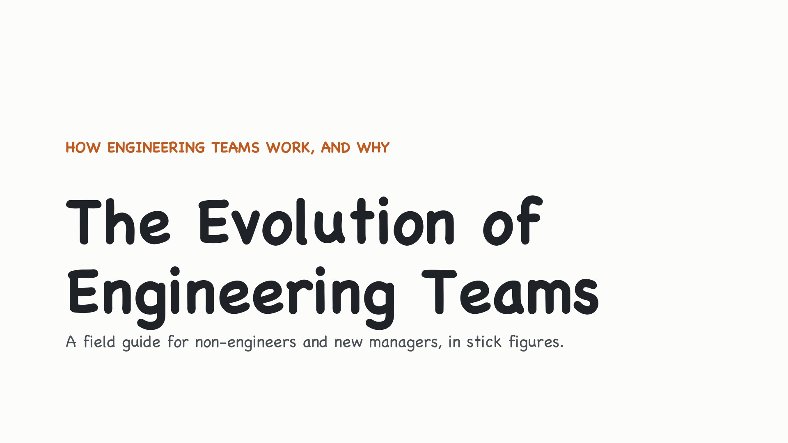

> Opening. Who this is for: people who work with engineering teams but haven’t been inside one, and new managers who want the “why” behind how these teams behave.

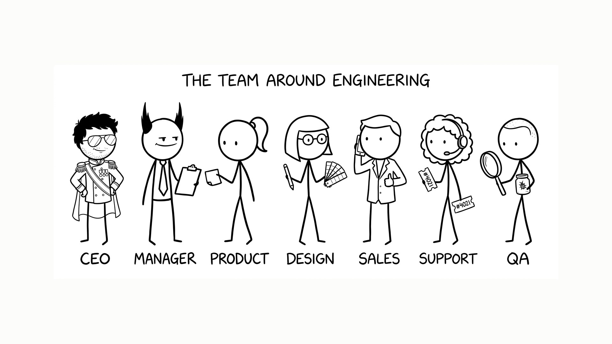

> Part 1: How an Engineering Org Grows. First, how a team grows: from one person with an idea to a whole organisation. Every step along the way is a sensible fix for a real problem.

> One engineer, one idea. State 1. One engineer, one idea, and the code they make: a cute little dragon. Remember the dragon. It grows.

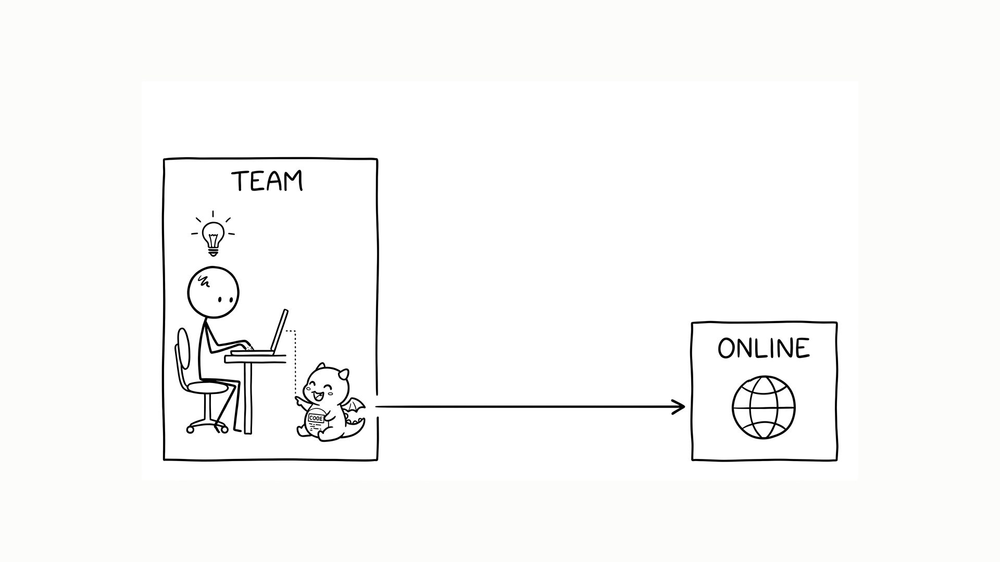

> Putting it online. State 2. What changed: the engineer just puts the code online. No testing, no release process, no customers yet.

> Building it out. State 3. What changed: the code grows, and so does what the engineer has to keep in their head. Still just a couple of squiggles.

> A visitor… who leaves. State 4. What changed: the first visitor shows up, looks, and leaves. Most early products go through several rounds of this before anyone stays.

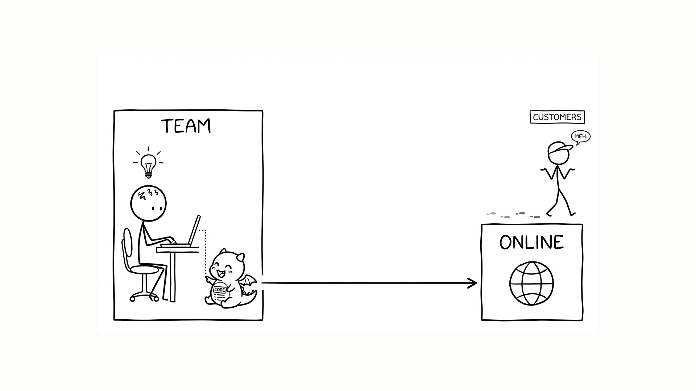

> Build more, try again. State 5. What changed: more building, another visitor, another “nah.” The code keeps growing even when nobody is using it yet.

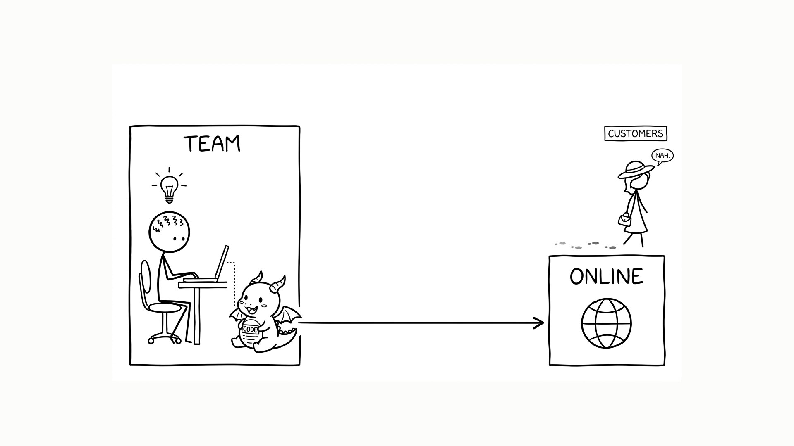

> A customer stays. State 6. What changed: finally, someone stays. The code is a lot bigger now, and it’s starting to have a personality of its own.

> But the problem with having a customer is... they notice when you break things. This is the first feedback loop: customers complaining when things don't work. In a small team, it goes straight to the right person.

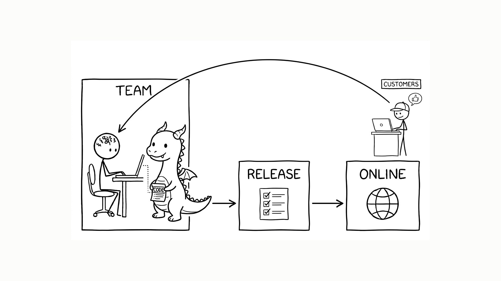

> So our engineer adds a new step. This is usually some automated tests & extra code to make sure what is being pushed will actually work. We call this the "release" step.

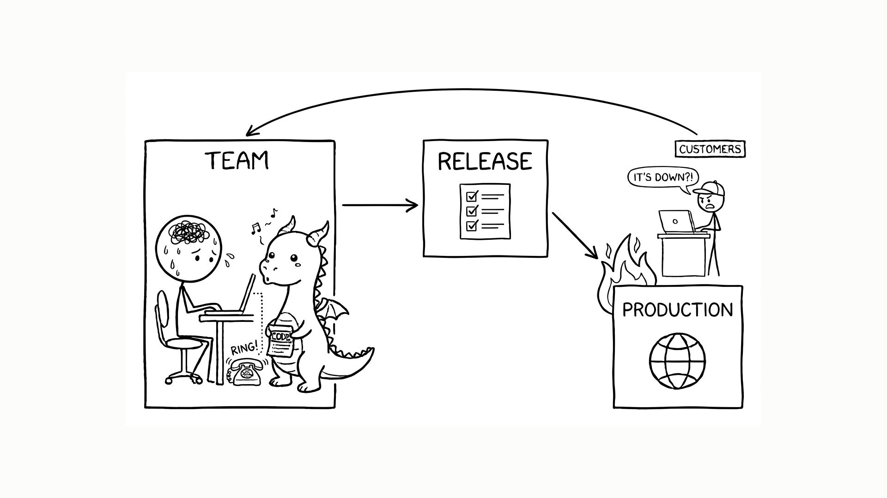

> But releases don't guarantee things won't break. AWS could go down. The hardware could fail. There could be some nasty bug that takes down the whole service.

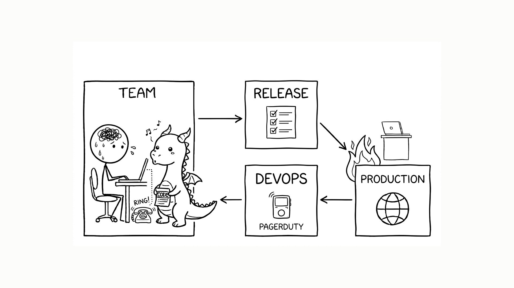

> When this happens, engineers will add an automated monitoring and "call home" system. We use PagerDuty + Prometheus for monitoring.

> It breaks when nobody’s watching. Slide 9c. What changed: production breaks with nobody using it. No customer complained, and the phone rings anyway, because the system now calls the engineer on its own.

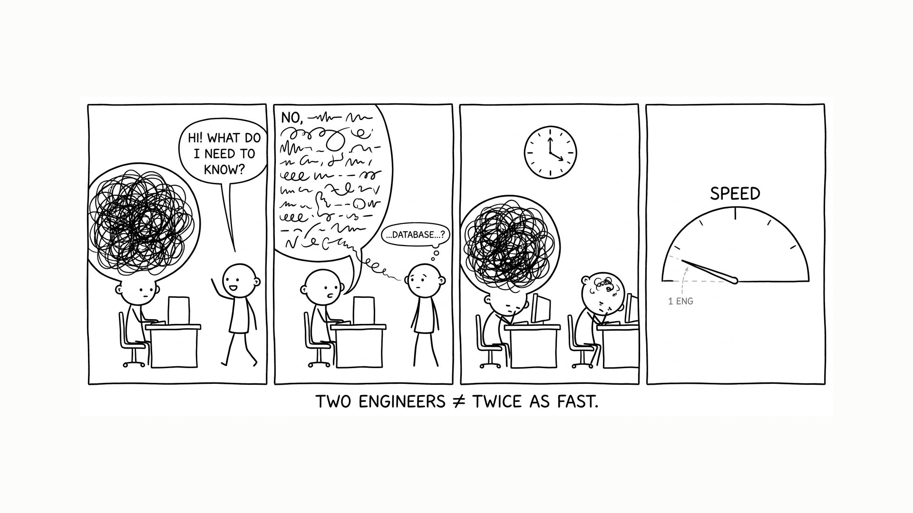

> A second engineer. Slide 10. What changed: a second engineer joins with an almost empty head. Everything they need to know has to travel down one phone line from the first engineer’s head. Small mouths, smaller ears. It’s manageable, but it isn’t free.

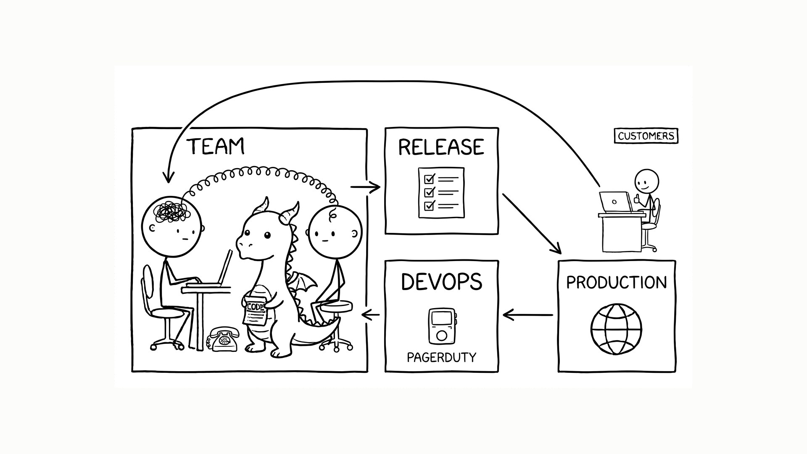

> Two engineers ≠ twice as fast. Strip before state 5. Everything the first engineer knows lives in their head, and it only leaves through a small mouth into even smaller ears. The new engineer’s ramp-up costs the old engineer’s time, so speed barely moves at first.

> Phone lines multiply. Slide 11. What changed: four engineers and a handful of customers, and almost every line still runs to the original engineer, because everything is in his head. One engineer has started acting as a “PM-light” with a tiny backlog. The dragon is getting bigger, and a little less cute.

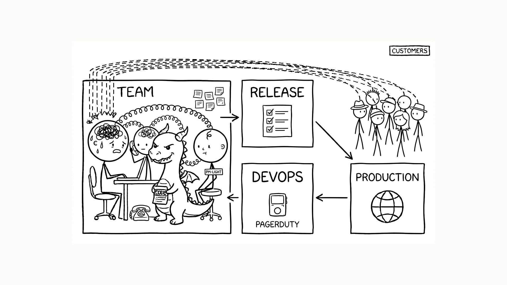

> A Product Manager. What changed: the PM-light gets pulled out into their own job. Every customer now talks to the PM, and the PM has one line into the team. The main engineer gets some of his head back.

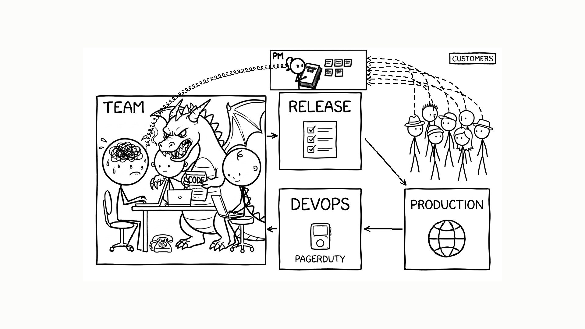

> The feature loop: out with customers. The feature loop, part 1. The PM leaves the office and goes to the customers. Everyone has a request.

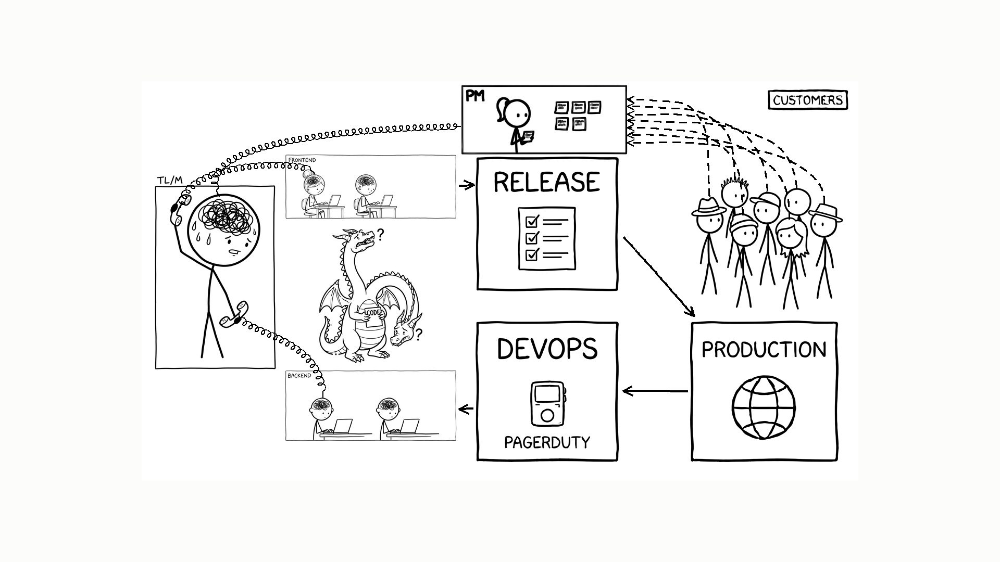

> The feature loop: the Product Plan. The feature loop, part 2. The PM comes back with a very big book of things for engineering to build. One phone line into the team, and the book keeps getting thicker.

> Two teams, and a TL/M in the middle. What changed: the team splits into frontend and backend, and the original engineer becomes the TL/M, in their own box, with a phone to each team; the PM now has one line, to the TL/M. Their brain is bigger than ever, because they’re the one who knows how both halves fit together. Each team’s heads are busy too. And the code didn’t split: the dragon sits between the teams, a head looking each way, and nobody is sure whose it is.

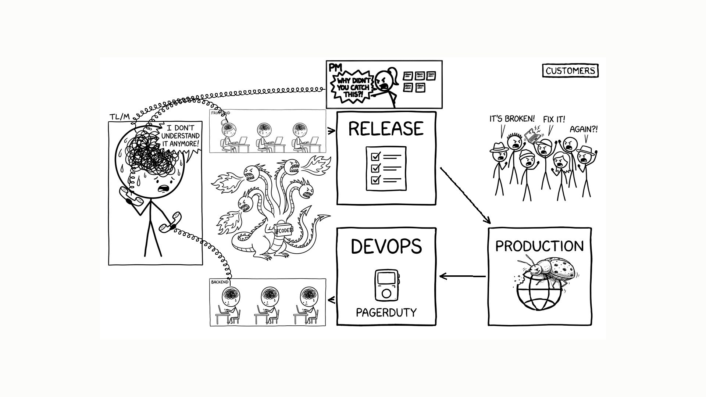

> A bug in production. What changed: a bug gets into production. The customers are up in arms and the PM yells: why didn’t you catch this? Each team has grown, the dragon has grown more heads and tails, and even the TL/M, the one person who held it all together, admits: “I don’t understand it anymore!”

> A test step: QA joins. What changed: a TEST box appears right before Release, and QA sits in it. Nothing ships until it passes TEST, and QA has a phone line back to each team to report what they find. The dragon is still huge and complicated, but under the magnifying glass it behaves itself: no more fire.

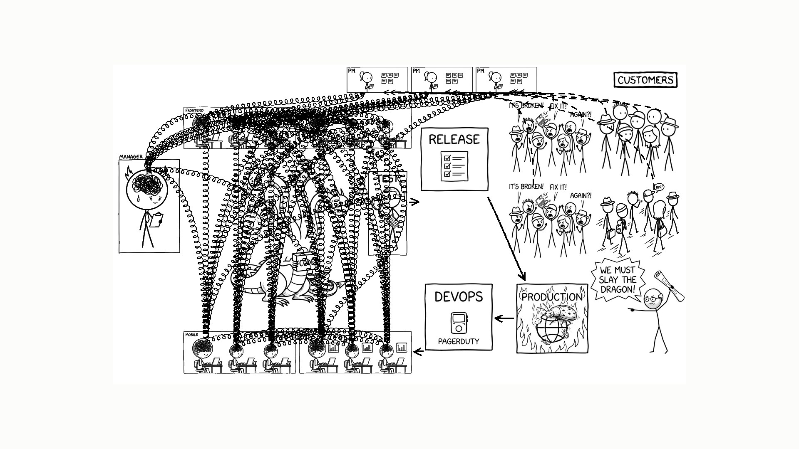

> Four teams, three PMs, one manager. What changed: lots more customers, so the PM role grows to three. Engineering is now four smaller teams surrounding the same dragon, and each team has grown its own big-brain engineer. The original big-brain engineer has become a manager. Every team still needs a phone line to every other team, because they all share one dragon: count the cords.

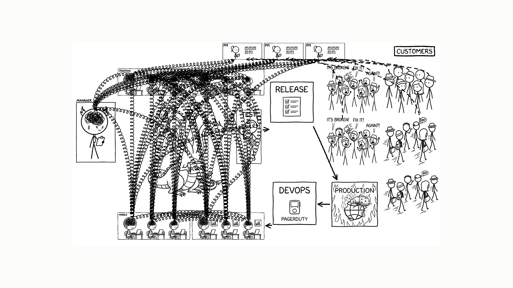

> Enter the Architect. Same picture, one new character. The Architect looks at the tangle of phone lines and sees the real problem: everyone has to talk to everyone because they all share one giant dragon. “We must slay the dragon!”

> The dragon, slain (four times smaller). What changed: the big dragon is split into four medium dragons, one per team, and each team gets its own Release → Production → PagerDuty loop. One QA person still tests for everyone. The phone-line mess is gone. The Architect is delighted, and the Manager’s brain has shrunk to a classic pointy-haired boss. But the untangling took a long time: the customers fell asleep, and the PMs are shouting “Is it done yet?!”

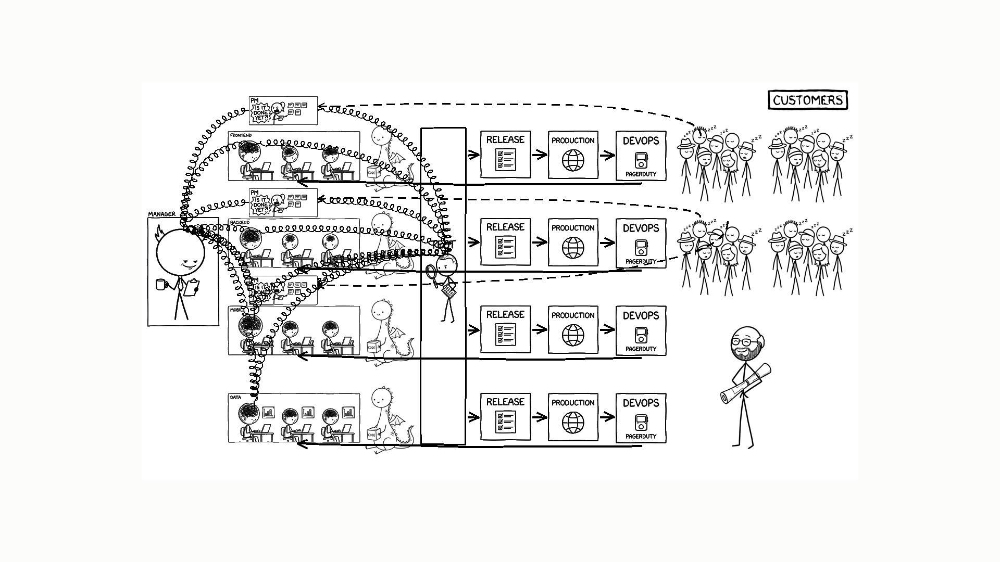

> QA splits, Support arrives. What changed: one QA person can’t keep up with four teams, so QA splits in two, each with phone lines back to the PMs and the team leads they cover. Customer Support shows up too, with one red emergency line: “SOS!” straight to an engineer, not a lead. Support can break through the system when it matters. It works: the customers are awake and chattering again, and the PMs are happy: “Moving faster!”

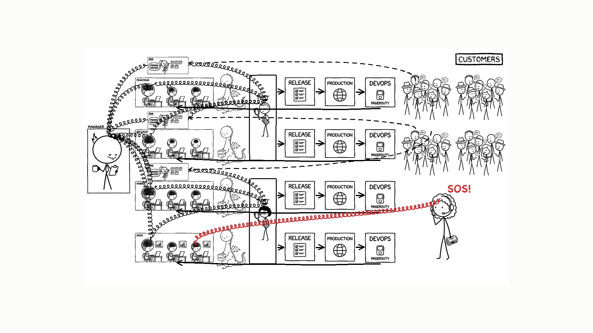

> A release catches fire. What changed: one team’s release goes up in flames. Four teams are each shipping on their own schedule, through their own release, and nobody is looking at all of them together. The Manager has no idea what happened. Support now sits in its own box, with a line to every PM.

> Air traffic control for releases. What changed: the four releases are grouped together, and a Release Manager watches over all of them like air traffic control, deciding what lands when. No more surprise fires, and the Manager is happy again.

> Who’s on call? What changed: one team’s DevOps / PagerDuty quietly disappears. Maybe the person left, maybe the rotation lapsed. Production still runs, but when it breaks, nobody gets paged. The Manager is confused again.

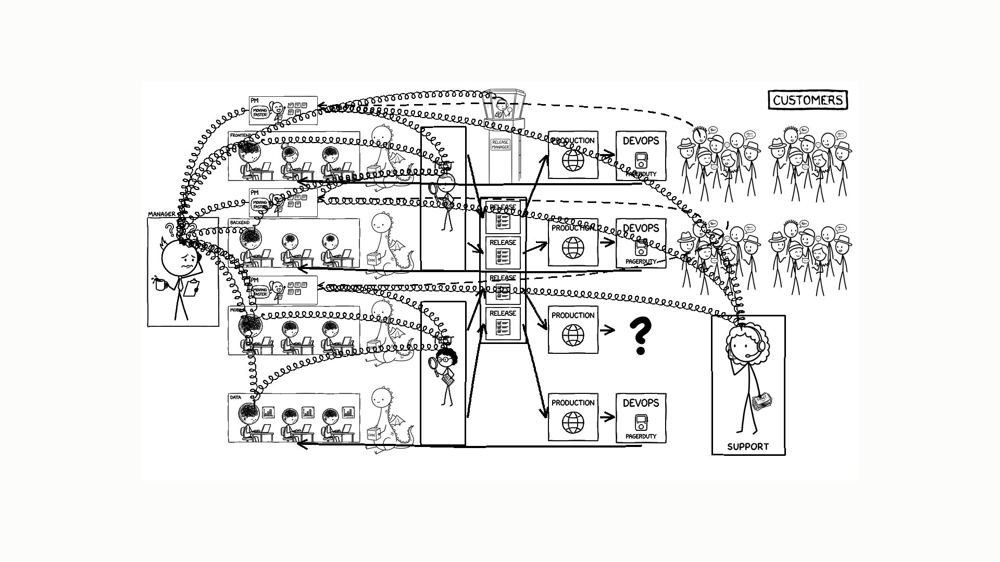

> Enter the SRE. What changed: the DevOps work is pulled together into one team that covers every product, so nothing falls through the cracks. And a new hero shows up: the SRE, whose job is keeping production reliable across all of them.

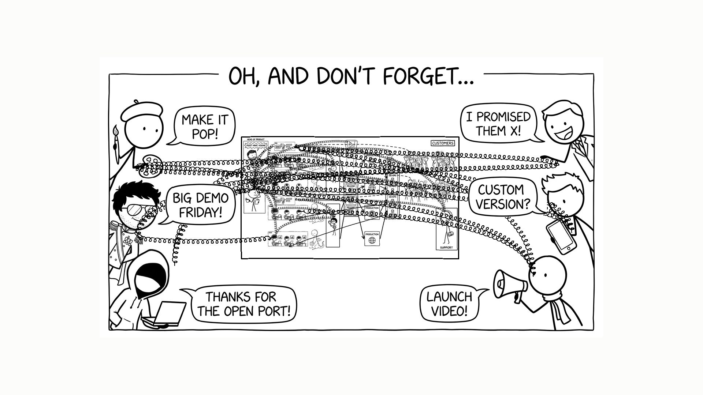

> Head of Product. What changed: with three PMs pulling in different directions, a Head of Product appears above them all, with a line to every PM: “Must have vision!” The Manager, who now has to square that vision with four teams, a Release Manager and an SRE, is confused again.

> Oh, and don’t forget… Zoom out, and the org chart was never the whole story. Design, the CEO, two Sales people and Marketing all want something, and a hacker has found the open port. None of them go through the structure: each one rings the Manager, a PM and whichever engineer picks up.

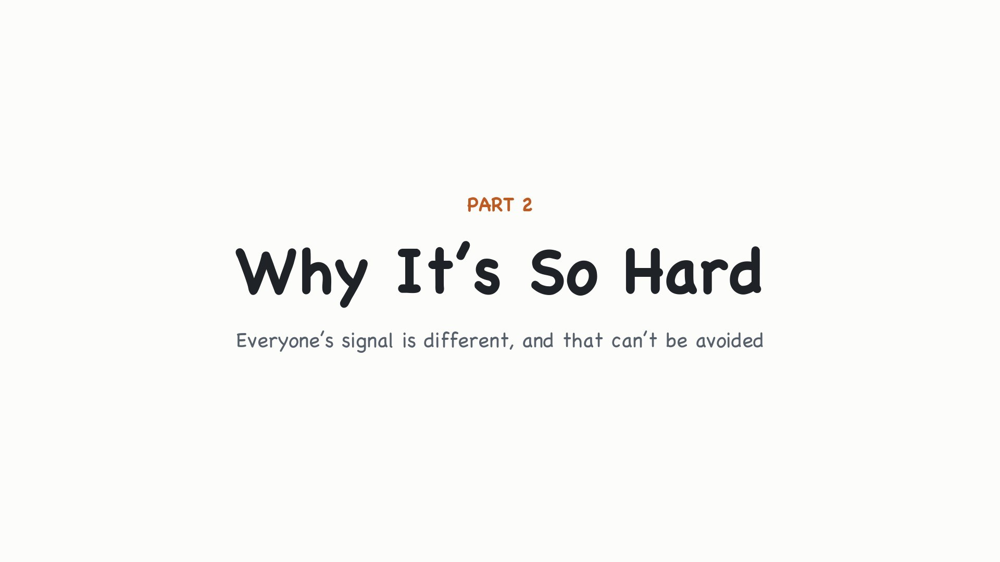

> Part 2: Why It’s So Hard. That’s how the org grows. Questions so far? Next: why, even with good people at every step, what gets built is never quite what everyone wanted.

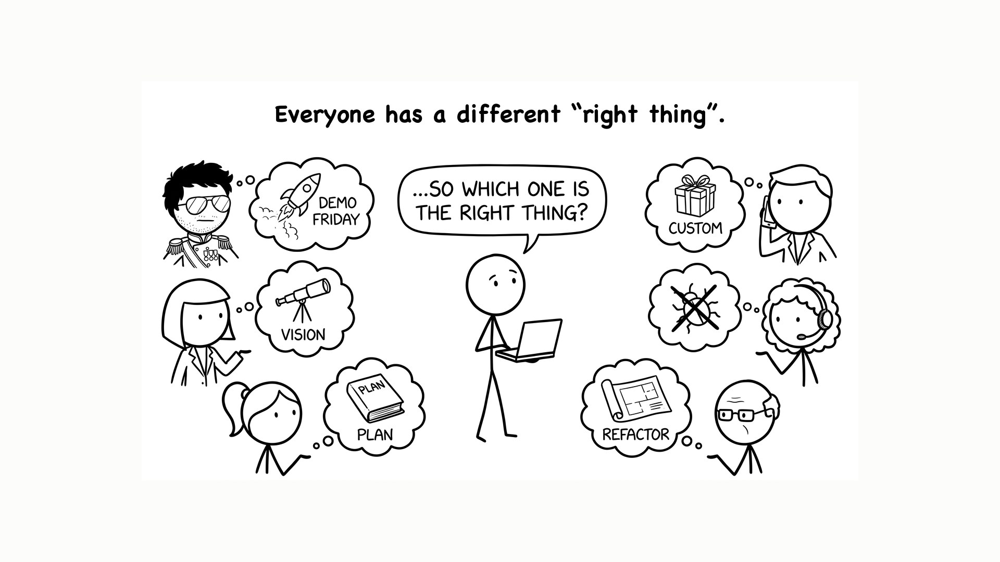

> The CAP theorem. There’s a famous result in computer science for any system spread across many places. You want three things: everyone has the same information, work never stops, and it keeps working when parts can’t reach each other. Every CEO wants all three. Let’s look at what each one costs.

> Consistency: everyone knows the same thing. For everyone to know the same thing, every pair of people has to stay in sync. Eight people is 28 conversations, fifty is over twelve hundred, and every one of these people wants something different. Keeping everyone consistent gets more expensive with every person you add, and it’s never finished.

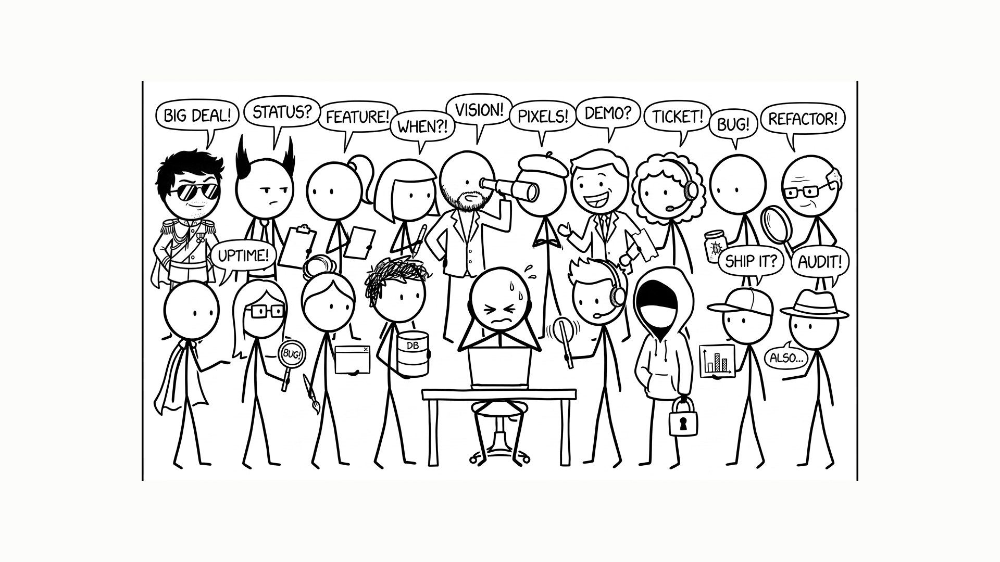

> Partition: on vacation. A partition is when people can’t reach each other. The simplest one: someone is on vacation, and what they know is on the beach with them. And they should be: we want people to take PTO.

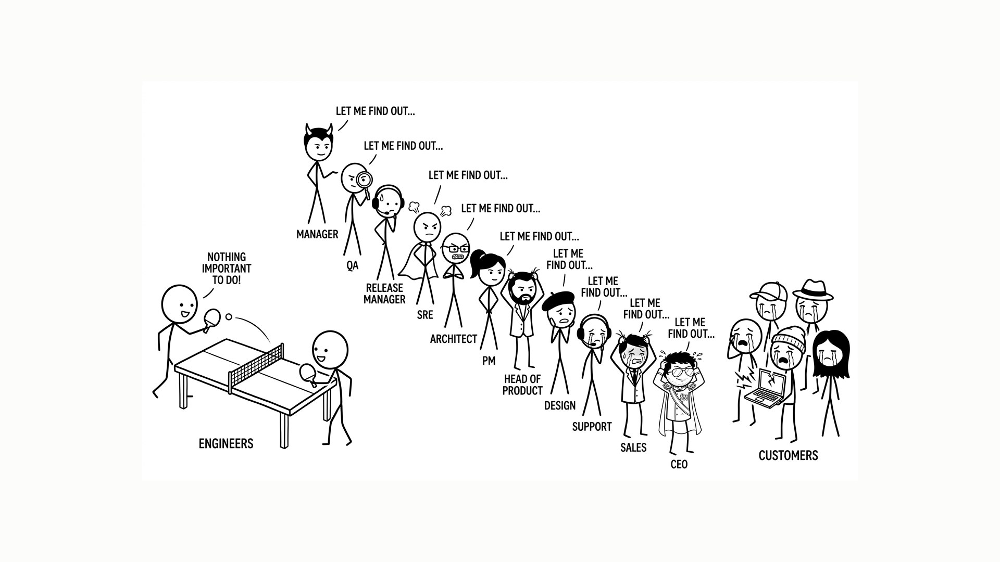

> Partition: gone for good. Sometimes the partition is permanent. Someone quits, and everything they knew that wasn’t written down leaves with them.

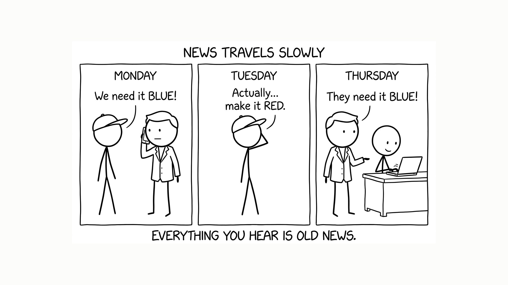

> Partition: just busy. Most of the time it’s not vacation or quitting. People are just busy. The PM needs an answer from Sales, Sales is with a customer, and the engineer needs to pick A or B today. In an org, partitions aren’t the exception. They’re the normal state.

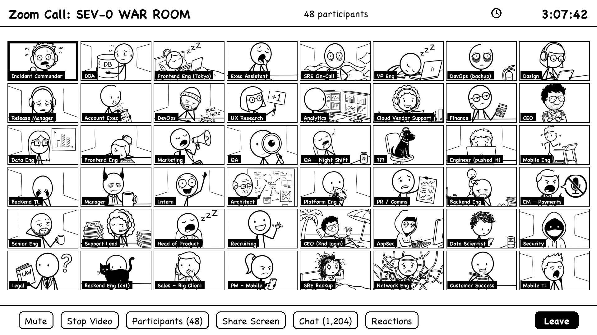

> Availability: work never stops… right? Availability means work never stops. But if you insist on consistency, everyone in sync before anything moves, then every partition stops the work. Somebody is always out, so nothing ever ships.

> The CAP theorem. Turns out, there is a famous computer science proof showing this is unavoidable. You can’t just hire better people. It’s called the CAP theorem, and it says you can only have 2 out of these 3 things. AND: organizations MUST have partitions, so our choice is between Availability and Consistency. Obviously, we choose availability. So we can never have consistency. Dammit.

> Everyone has a different “right thing”. Everyone has a different view of what is important, and what should be built when. None of them are wrong: each one is looking at a real problem from where they sit. The engineer is the one who has to turn all of it into a single thing to build.

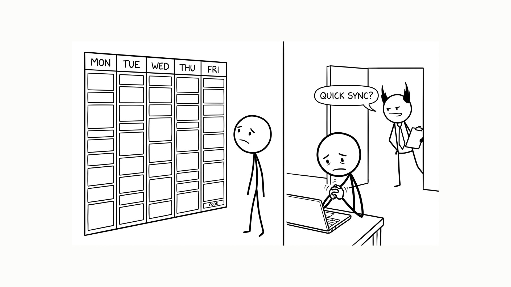

> …and every signal arrives differently. And each of those signals reaches each engineer at a different level of clarity. Sometimes the feedback loop doesn’t exist at all. Sometimes it goes to the wrong people. Sometimes the data coming in is wrong and can’t be trusted.

> …and that’s why. Whatever ships, somebody’s signal got lost on the way. That’s the title of this talk. And it’s not because anyone is bad at their job. Questions before we look at how it goes wrong?

> Part 3: Avoiding Complete Chaos. We can’t get rid of the trade-off, but we can manage it. Every hurricane starts as a little storm: a small, sensible-looking step that nobody breaks up, until it organizes into chaos. Here are the little storms to watch for.

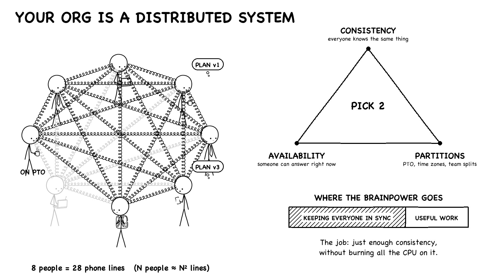

> Guess there’s nothing to do… Everything is humming, so the strategy folks retreat to the boardroom to present a new vision, and the engineers, cut off from the customers, stand around the coffee machine wondering what any of it means. Meanwhile the customers walk out the door, straight to the competition, where a single engineer is happy to help.

> Everyone wants something. Without the structure, every role goes straight to the engineer, and they all want something different, right now. The engineer has no idea what to do first.

> Let me find out… The opposite failure. So many layers sit between the engineers and the customers that nothing gets through: every layer says “let me find out…”, frustration builds the closer you get to the customer, and the engineers think there’s nothing important to do.

> The CEO side door. The CEO grabs one engineer directly, and the engineer happily starts. Meanwhile, the PM and tech lead promise a customer a feature from the very same engineer. Nobody knows about the other promise until the engineer is stuck between them.

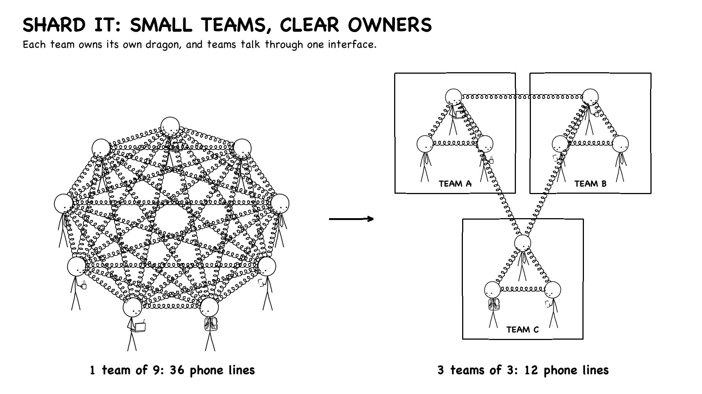

> The promise that got lost. Sales promises a customer something specific. By the time it’s passed through PM and tech lead, the engineer hears something else entirely, and builds that. The fire comes months later, when the customer finds out.

> What’s the top priority? The Architect, PM, Support and Sales each have a different “top priority”, and they fight it out. Until they agree, the engineer has nothing to do but watch.

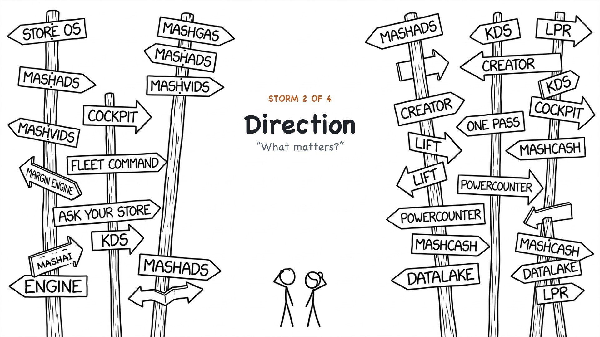

> If the system gets too complicated, it becomes very hard to figure WHAT and WHO is responsible for fixing it. Nobody understand the whole system anymore. A common clue that this is a problem are huge war rooms where everyone gets pulled in to help, because nobody knows who actually can.

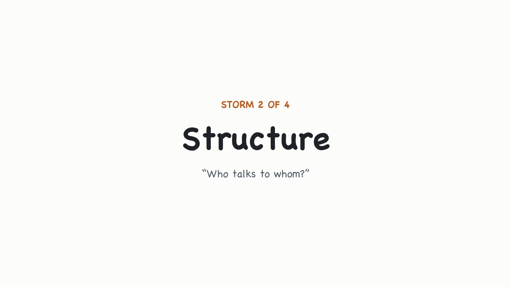

> The hero dependency. One engineer built the whole integration for our biggest new customer, so every question, from the CEO to Support, goes to their head. Then they go on PTO exactly as we launch. Nobody else knows how it works, and the launch catches fire. When knowledge lives in one head, that person is a single point of failure.

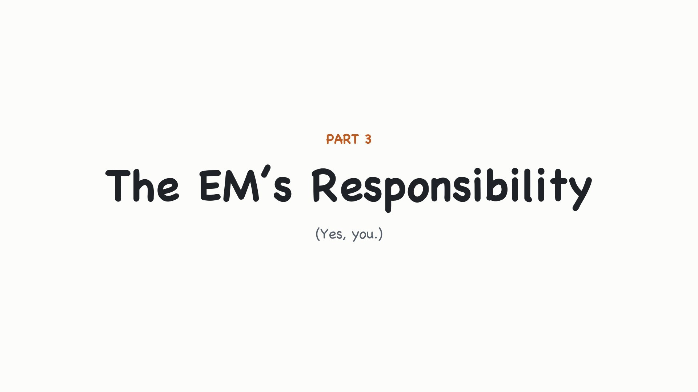

> Reorg whiplash. You can’t change things too fast, because people need time to build relationships and transfer knowledge.

> Meeting creep. Every coordination problem gets “solved” with another recurring meeting: a sync, a standup, a planning session, a retro. Each one makes sense on its own. Together they leave engineers a sliver of Friday to actually build anything, and even that gets a “quick sync”.

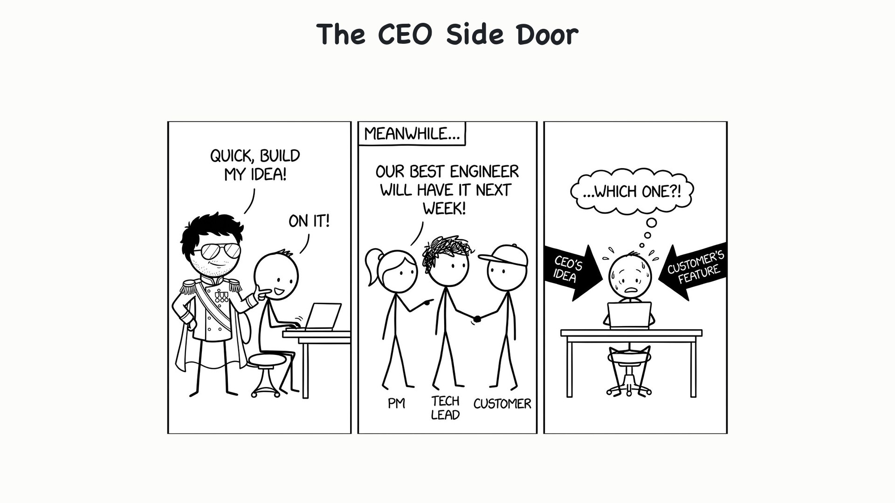

> Engineers aren’t fungible. “We can put Boris on it.” Boris is great, and his head is full, but it’s full of his old team’s system: blue, not red. The new team’s engineer has a head just as full of the red system, and it can only come out one thin strand at a time, through a tiny mouth into tiny ears. Two weeks later, very little has made it across. Moving a strong engineer to a new team doesn’t move their knowledge with them.

> Part 4: Techniques for Solving This. We’ve seen how it goes wrong. Now: what actually helps.

> Your org is a distributed system. N nodes means N² communication possibilities. Every person holds state. Nodes disappear. You get consistency problems. Every conversation is an RPC. This is a distributed systems problem, and the CAP theorem applies. The job is to balance “eventual consistency” against the CPU burned on achieving it, versus doing useful work.

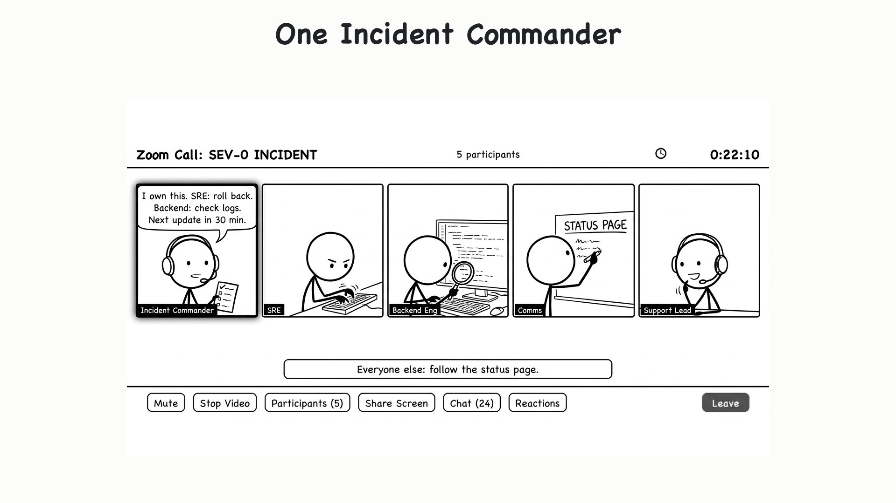

> Shard it: small teams, clear owners. The first fix is the one the Architect found: cut N down. Small teams that each own their own piece of the system (their own dragon) talk mostly inside the team, and across teams through one interface. Nine people in one team is 36 phone lines; three teams of three is 12.

> Write it down: broadcast, don’t RPC. Telling people one at a time is an RPC per person: it’s slow, it costs the sender every time, and every retelling drifts. Writing it down is a broadcast: one write, many reads, async, and it’s still there for the person who was on PTO. Decision logs, weekly notes, a short doc.

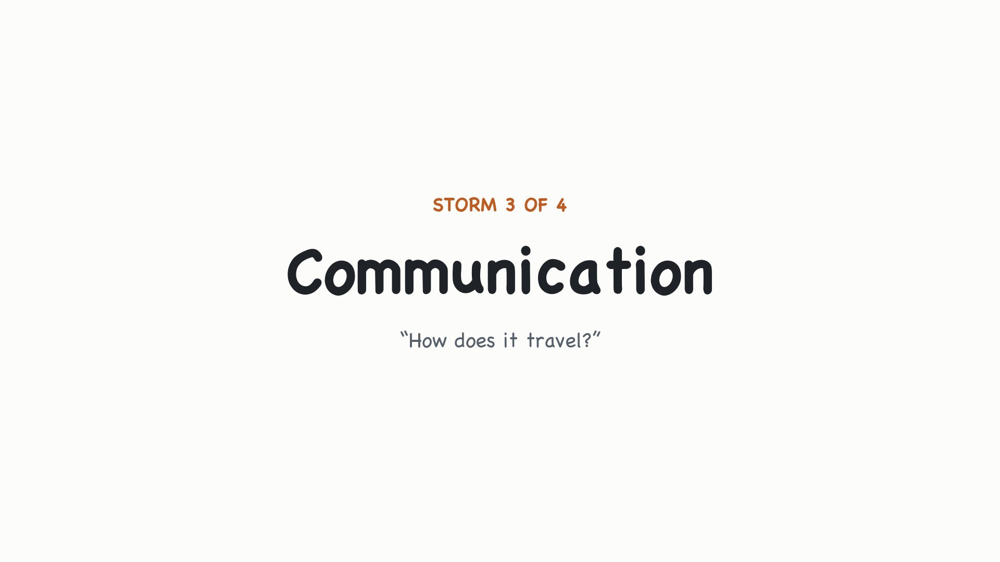

> One owner per decision. Consensus is the most expensive protocol there is: every node has to talk to every other node, and it never quite converges. Give each decision a leader, a DRI. They gather input, decide, and tell everyone why. Everyone else only has to hear the answer.

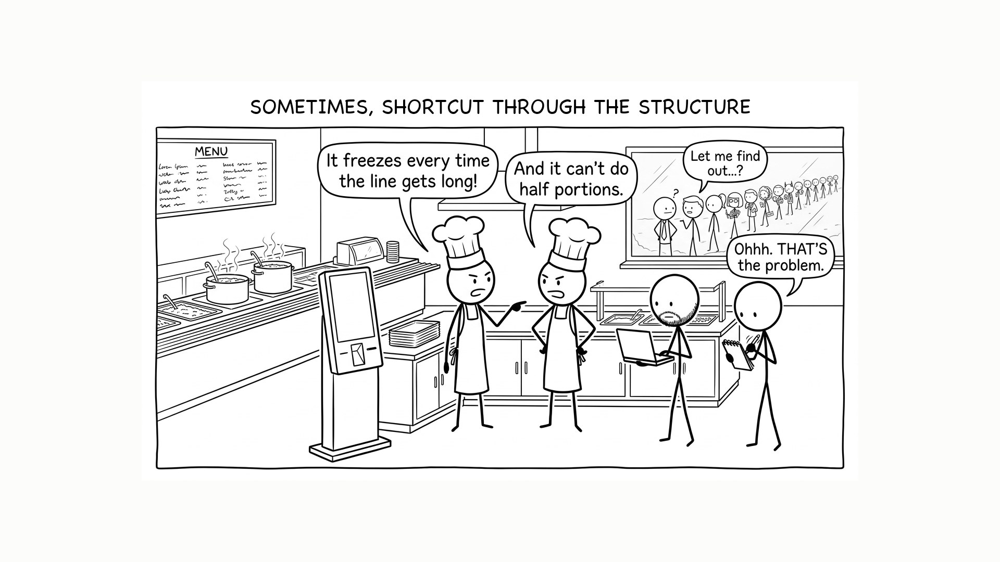

> Heartbeats and batching. Distributed systems use heartbeats and batching instead of chattering constantly. Teams can too: a short predictable standup, office hours for questions, and long uninterrupted blocks for actual work. Real emergencies still page on-call; everything else waits for the next heartbeat.

> Part 5: The EM’s Responsibility. So what does this mean for you, the engineering manager?

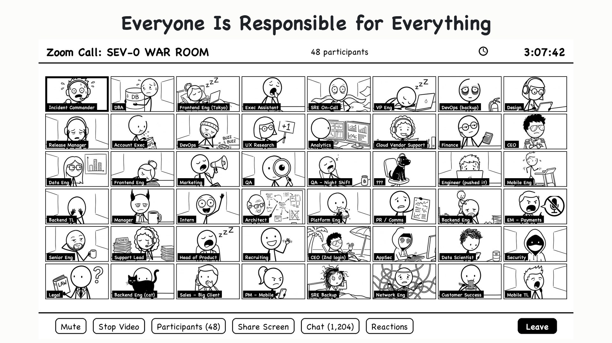

> Isn’t this the VP’s problem? Isn’t this the VP’s problem? Why do I need to think about this? Because the VP sees the org chart, the boxes. You see the lines: most of the N² phone lines in the org run through your team, and through you.

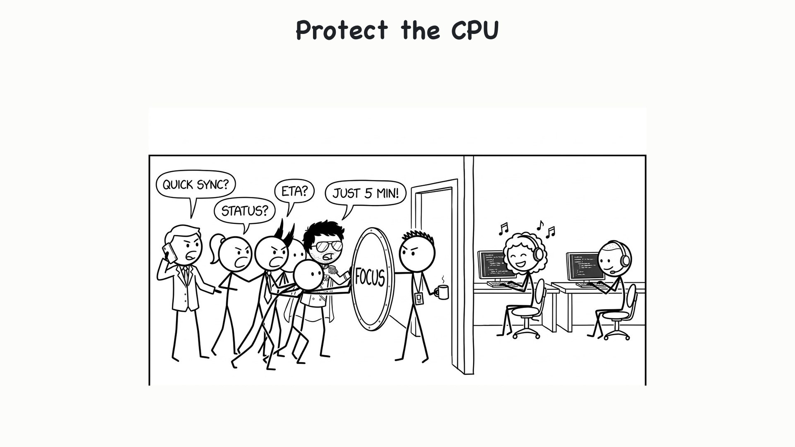

> Who needs to know what, when, and why? WHO needs to know WHAT, WHEN, and WHY? WHERE are they going to learn it? If you don’t have this mental model, then you can’t help the system become eventually consistent, and knowledge gets stuck. Yes, you’re just a fancy router. Sorry.

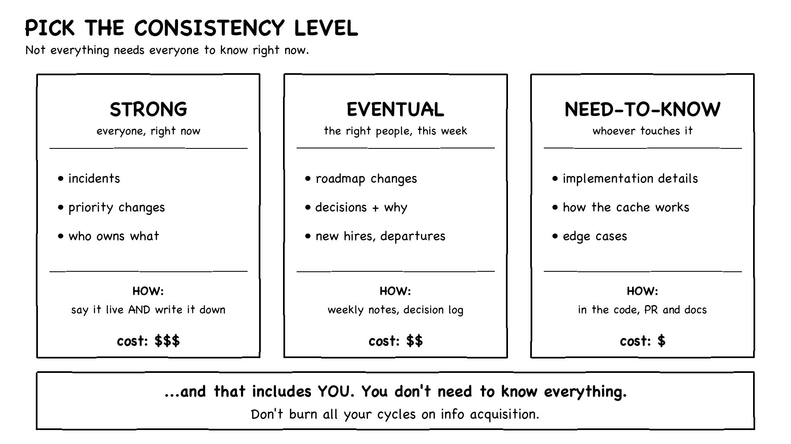

> Find where knowledge is stuck. Part of the router job is knowing where knowledge is stuck: the one person who understands billing, the deploy script only one person can run. A bus factor of one is a bug. Fix it on purpose: pairing, rotation, writing it down, before that person goes on PTO.

> Protect the CPU. The other half of the job: protect the CPU. Every “quick sync?” is a context switch for an engineer. Take the questions yourself, batch them, answer them in writing, and send one person to the meeting instead of five, so the team can spend its cycles on useful work.

> Pick the consistency level. Not everything needs strong consistency. A few things need everyone to know right now; most things only need the right people to know eventually; a lot only needs to be findable by whoever touches it. And that includes you: you don’t need to know everything. Don’t burn too many cycles on info acquisition.

> Shape process to fit goals. Process is plumbing: it exists to get work to the goals. When the goals change, change the process. Be comfortable throwing out last quarter’s pipes.

> Standups and virtual teams. Standups are expensive, synchronous events, and super high bandwidth. Use them judiciously, and get the right people in the room. Virtual teams are great: bring in, temporarily, the people who unblock you.

> Cross-functional goal meetings. Weekly or bi-weekly, with everyone in the company who can affect a major goal: Customer Weekly, Store Health, and so on. No excuses for the business not to be aligned.

> Meet the cast: the team around engineering. The people engineering works with every day. Each one pulls the team in a different direction: the CEO sets the vision, Product decides what to build, Design how it should feel, Sales what was promised, Support what’s broken right now, and QA what’s broken before anyone else finds it.

> Meet the cast: the engineers. “Engineer” isn’t one job. Frontend builds what you see, backend what you don’t, DevOps keeps it running at 3am, Data/ML turns data into decisions, Mobile lives in the app stores, Security assumes everyone is an attacker, and the Architect worries about how it all fits together in two years.
