# Winning, and Increasing the Capacity to Win

*A stick-figure talk about the two halves of an engineering manager's job.*

Wade Chambers says a manager has two jobs: win, and increase the capacity to win. That sounds like nothing, so this talk makes it concrete with the dumbest possible analogy: moving a huge pile of bricks from A to B. It defines both halves, shows why they fight over every hour of your week, and then walks through ten tools for each.

See also: [Winning](../winning/) and [Increasing the Capacity to Win](../increasing_the_capacity_to_win/) in the Cookbook. The working outline is in [outline.md](outline.md), and ideas for future iterations are in [TODO.md](TODO.md); the slide sources, images and image prompts are in [source/](source/). Downloadable versions of the deck (PDF, PowerPoint with speaker notes, and a standalone HTML presentation) are in [export/](export/).

Copyright Dobromir Montauk 2026.

## Slides

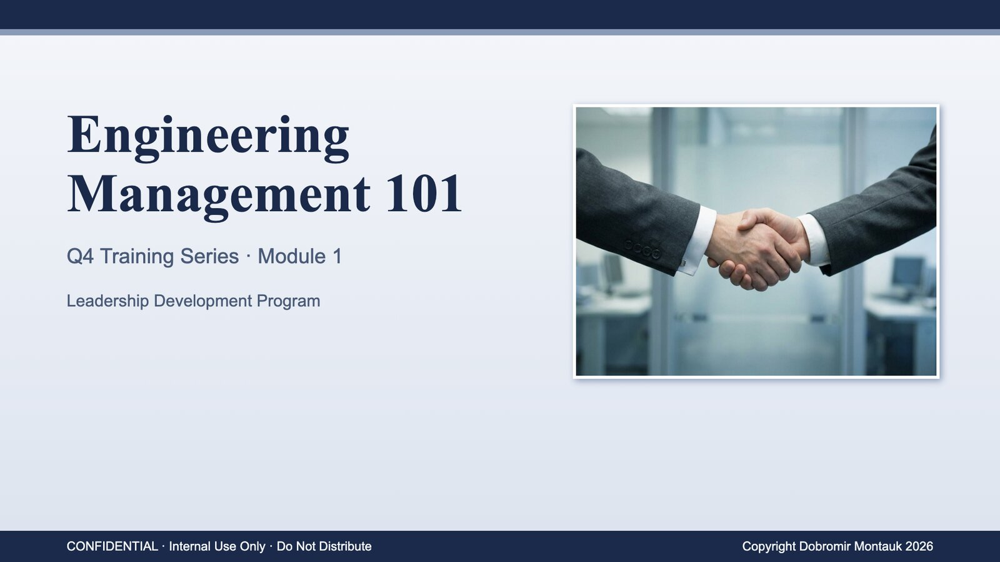

> Deliver it with a completely straight face, like the start of every training you’ve ever sat through. Let the pause run a beat too long.

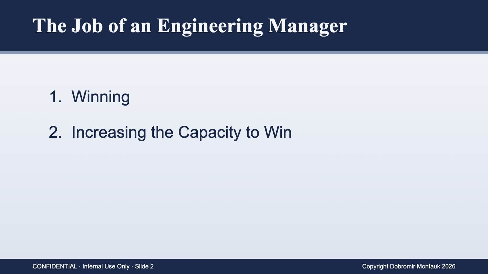

> Read it flatly. This is literally the whole talk, and it sounds like nothing. Ask the room what it actually means. Wait. Nobody will answer.

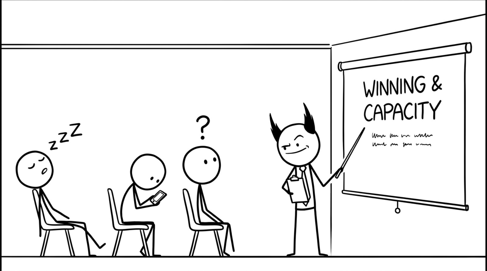

> Admit it: I wrote that slide and I’m not sure either. “Winning” and “capacity” are words we nod along to in meetings. By the end of this, you should be able to use them to make a decision on Monday.

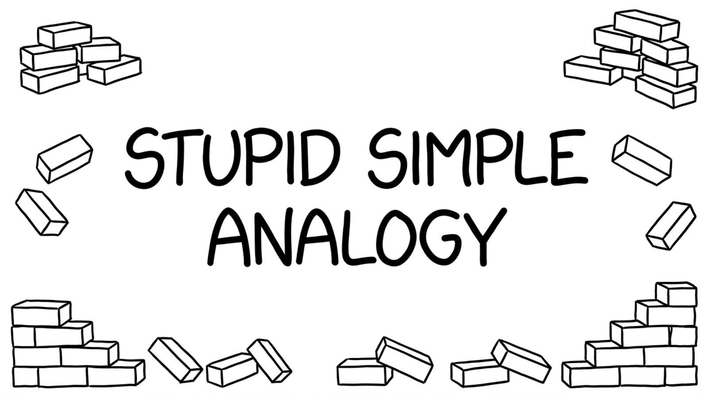

> A stupid simple analogy. Let’s make it concrete with the simplest job imaginable: bricks. 
>
> (yes, because it is so stupid-simple, it won't map 1:1 with our jobs. That shouldn't prevent you from getting the lessons)

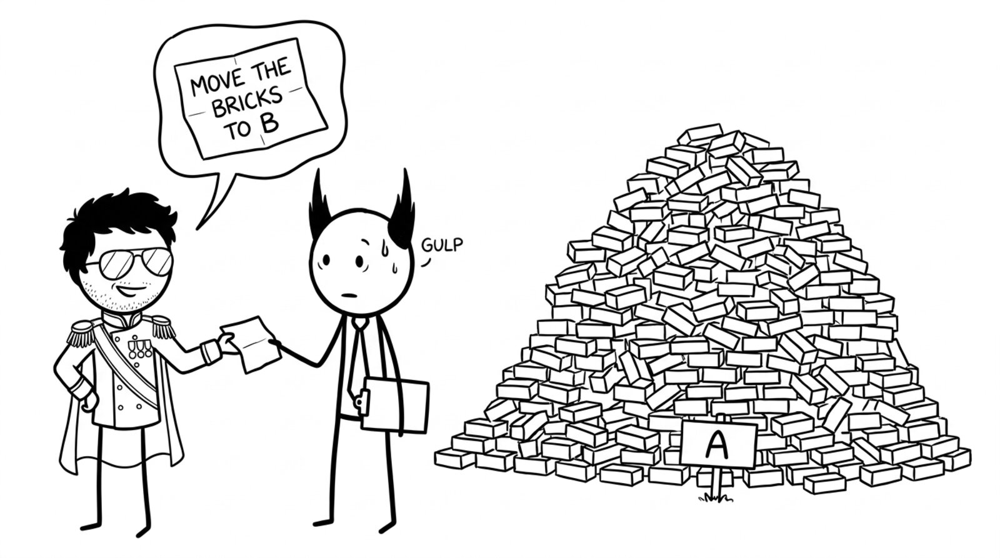

> Every EM gets some version of this note, usually with less detail. You have to build the team, and the technology, to get it done. Why bricks? Shipping features isn’t that different: units of value, hauled to a customer who’s waiting at the other end.

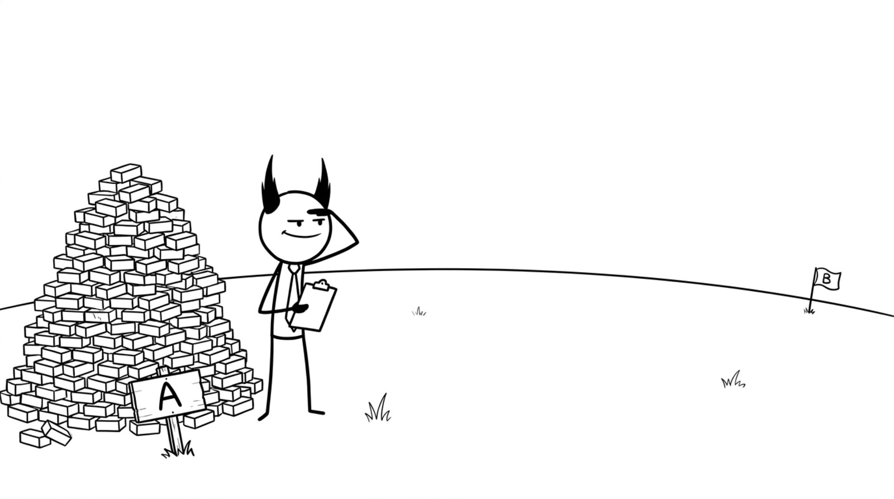

> Notice what nobody told you: how big B is, how far away, or what’s in between. Every one of those unknowns is going to bite us later. Hold that thought.

> A win is one turn: one week of engineering. Both factors matter. A thousand bricks moved sideways scores zero; one brick delivered all the way counts. Ask the room: by this measure, what did your team win last week?

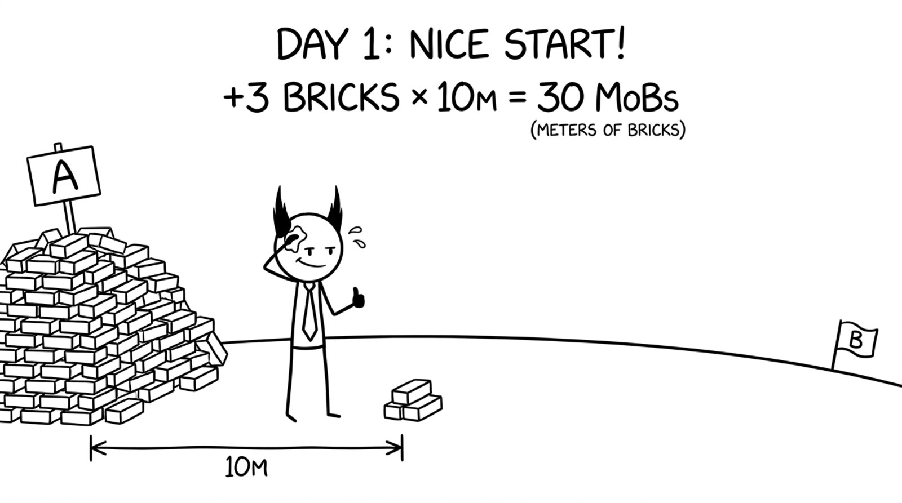

> Celebrate it: it’s a real, measurable win. Then do the math out loud. How many bricks are in that pile? How far is B? Let the room get a little uneasy.

> If ALL the bricks don’t arrive by date X, all that winning is worthless. Keep Day 1’s pace forever and we finish in 300 days; the deadline is months before that. This is the moment winning alone stops being enough.

> Capacity is everything that doesn’t move a brick this week but lets you move more later: tools, roads, people, skills. Why discount? Because the future is uncertain. The truck might take two years; the Starship may never fly. With any real discount rate, the moonshot has to be enormously bigger to beat the wheelbarrow. The skill isn’t picking the biggest number; it’s picking the best impact for the time.

> Same deadline, same pile. What changed is capacity: better tools, more people, more bricks per trip, and it compounds. That’s how you beat a deadline you can’t beat at today’s pace. But “just made it” isn’t comfortable: one more surprise and we’re back on the scary slide.

> There’s no answer that’s always right. Some days the bricks have to move. Some days the best thing you can do is train the new guy. Every hour on one side is an hour not spent on the other. The rest of this talk is about making that call well, every hour, every day.

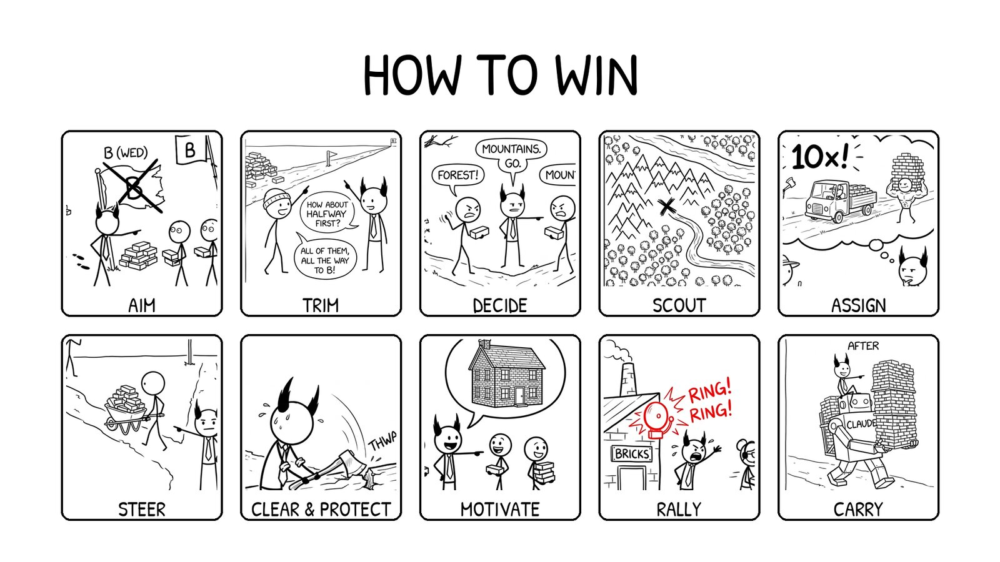

> Each of these can be a whole course by itself. We're just going to lightly touch each one & give some examples so you can pattern match your activities to the bucket they fall into.

![Slide 14: Aim. A field seen from the side. Pile A of bricks on the left. Three old flags still stand across the field, each crossed out with a big X and labeled B (MON), B (TUE) and B (WED), each with a small stack of bricks the team delivered there for nothing. Footprints lead from A to the first flag, and from A to the second and on to the third. There the Manager points to the right, where the customer in a knit beanie is planting the real flag B on empty ground; three engineers holding bricks look on, surprised.](slides/14.jpg)

> Goals move all of the time, for lots of different reasons. The work your team is does only matters if it takes you *in the direction of the goal* -- so even if you are a little off-track, you are wasting effort. Figuring out what is the actual goal will help THIS WEEK's work be maximally productive.
>
> 1. The feature for a deal that died. A team spends six weeks building a custom integration for a big prospect. The deal falls through. Nobody else wants the integration, so it sits in the codebase as a cost.
> 2. Built to someone else's understanding. The PM passes along what sales heard on a call. Engineering builds exactly that, but the customer meant something else, so it gets rebuilt. The first version was the passed-down scope, not the real one.
> 3. Polishing what's about to be replaced. Three weeks go into speeding up and hardening a service that leadership already plans to replace next quarter. Nobody told the team, and all the work dies with the old system.
> 4. Building on the API the customer is leaving. The team ships an integration against a vendor's v1 API, then learns the customer is migrating to v2 (or to a different vendor) next month.
> 5. Two teams, one problem, opposite directions. Two teams each build their own version of the same thing, like an auth library, a reporting pipeline or a config system. One version gets thrown out, along with the time spent arguing over which survives.
> 6. Gold-plating the prototype. A spike meant to answer "will this work?" gets tests, a CI pipeline and a nice UI. Then the answer comes back no.
> 7. The right feature for the wrong user. A powerful configuration screen gets built for admins, but the people who actually hit the problem are front-line staff, who never open that screen.

> Two kinds of scope to cut. On the left, approach scope: the framework, the platform or the automation we would love to build first. Building tools is capacity, not winning, so do it on purpose, not by accident. On the right, product scope: the castle the customer asked for vs. the house they actually need this quarter.
>
> Examples:
> 1. Approach scope. A request for one flag on one machine turned into a design for tiered config with merge rules and a new admin UI. Someone asked, "any objection to the hackiest possible approach?" A one-off override solved it that day.
> 2. Approach scope. An engineer wanted a generic plugin system first, so integrations would be "easy forever". There was one integration on the roadmap. Hard-code it; build the abstraction from three real examples later, not zero.
> 3. Approach scope. Support wanted an edge case automated before launch. How often does it happen? About once a week. Keep it manual for now, and launch.
> 4. The other side. A simple database index was suggested early and passed over because the tests weren't representative. Seven weeks later, under production load, the same index took the query from 4.5 s to 0.7 s.
> 5. Product scope. The customer asked for a full analytics dashboard: filters, charts, scheduled emails. The question "what decision is this for?" turned up one weekly number for the CFO. A nightly CSV export shipped in two days.
> 6. Product scope. The spec said "supports every payment type". The data said 97% of transactions were cards. Launch with cards, a month early; add the next type when a real customer asks.
> 7. Product scope. The plan included a full admin UI for config, roles and audit logs. The only users were three internal engineers. A documented script and a config file in the repo did the job and saved six weeks.
>
> Caveat: a trimmed feature still has to be usable. Phase 1 can be manual, but call it a partial feature, not GA. "Done" means what the customer expects.

> Two kinds of scope to cut. On the left, approach scope: the framework, the platform or the automation we would love to build first. Building tools is capacity, not winning, so do it on purpose, not by accident. On the right, product scope: the customer wants every brick, all the way to B. Halfway, delivered first, is usually what they actually need this quarter, and it's worth something on its own.
>
> Examples:
> 1. Approach scope. A request for one flag on one machine turned into a design for tiered config with merge rules and a new admin UI. Someone asked, "any objection to the hackiest possible approach?" A one-off override solved it that day.
> 2. Approach scope. An engineer wanted a generic plugin system first, so integrations would be "easy forever". There was one integration on the roadmap. Hard-code it; build the abstraction from three real examples later, not zero.
> 3. Approach scope. Support wanted an edge case automated before launch. How often does it happen? About once a week. Keep it manual for now, and launch.
> 4. The other side. A simple database index was suggested early and passed over because the tests weren't representative. Seven weeks later, under production load, the same index took the query from 4.5 s to 0.7 s.
> 5. Product scope. The customer asked for a full analytics dashboard: filters, charts, scheduled emails. The question "what decision is this for?" turned up one weekly number for the CFO. A nightly CSV export shipped in two days.
> 6. Product scope. The spec said "supports every payment type". The data said 97% of transactions were cards. Launch with cards, a month early; add the next type when a real customer asks.
> 7. Product scope. The plan included a full admin UI for config, roles and audit logs. The only users were three internal engineers. A documented script and a config file in the repo did the job and saved six weeks.
>
> Caveat: a trimmed feature still has to be usable. Phase 1 can be manual, but call it a partial feature, not GA. "Done" means what the customer expects.

> Often you have to make the call before you have enough data. Teams lose days, sometimes weeks, waiting on decisions nobody owns. The cost isn't the two people arguing; it's everyone blocked behind them.
> - Two senior engineers debate the data model for two weeks while the rest of the team can't start.
> - A design review ends with "let's take this offline" for the third time.
> - A PR sits blocked on an architecture argument in the comments.
> - "Which customer first?" goes unanswered, so people pick their own.
> Most technical decisions are reversible. Set a deadline for the decision, hear both sides, make the call, write down why, and revisit if new data shows up. Disagree and commit.

> On the last slide we picked the mountains with no data. A scout would have found that dead end in two days. Scouting ahead is more work up front, but it's cheaper than committing the whole team to the wrong road for a month.
> - Spike the vendor or POS API for two days before promising the integration date: auth quirks, rate limits, missing endpoints.
> - Prototype the hard part first (latency, the hardware constraint, the model accuracy), not the easy UI.
> - Ask who tried this before. The team that attempted it last year knows where it broke.
> - Read the customer's actual setup (network, hardware, existing POS) before estimating.
> Send one engineer for a few days, not the whole team for a sprint. The obvious approach is often the one nobody has taken end to end.

![Slide 19: Assign. Four specialists stand in a row: a truck driver with a steering wheel and keys, a strong guy flexing with a tall stack of bricks on his shoulder, a bearded lumberjack with an axe, and a scout with a hat, backpack and walking stick. The Manager faces them, hand on chin. His big thought bubble shows them all at work on one road: the scout leads through the forest, the lumberjack clears trees, the truck drives a load of bricks, the strong guy carries a huge stack. In the bubble: 10x!](slides/19.jpg)

> Engineers aren't fungible. The person who knows the payment stack fixes the payment bug in a day; someone new to it takes a week.
> - Your best debugger goes on the production incident.
> - Your best communicator goes on the customer-facing integration.
> - Your fastest prototyper takes the spike.
> - Watch for assigning by "who's free" instead of "who's best for this".
> When one task blocks everything (the release, the P0 bug), swarm it. The tradeoff: always picking the expert creates hero dependency. Spreading knowledge is capacity, and it comes later in the talk.

> Three customers, three deadlines, and each one is sure they're the priority. Your job is to turn the noise into an order: value, deadline, size.
> - The big launch due Monday gets most of the team.
> - The small fix for a key account due Tuesday gets one engineer, so it ships and is off the board.
> - The Friday request waits on purpose, and you tell that customer explicitly, with a date.
> Spread the team across all three and everything ships late. Re-check mid-week: did priorities change? Did sales promise something new?

> Two kinds of obstacles.
> Blockers you can see: waiting on another team's API, missing access or credentials, a flaky CI pipeline, a decision nobody has made. Chasing these down is visible and feels great.
> Distractions you don't see: the "quick favor" from sales, the exec who needs "just 5 minutes" every day, an extra interview loop, the side project someone pulled your engineer into. They take your best people one at a time.
> Ask in 1:1s where their time actually went last week, and compare it to the plan. Then say no on their behalf.

> People work harder on things they understand and care about.
> - Bring an engineer to a customer site to watch the product being used.
> - Share the real number: the revenue, the customer count, the deal this unlocks.
> - Connect the project to their career: this is the scope that gets them promoted.
> - Celebrate the ship publicly and name who did it.
> But don't oversell. If the "company-changing" launch turns out to be a pilot at one site, the next pitch lands flat.
> Overtime lives here too. A short push before a hard deadline can win the week, but it borrows from capacity: burnout, attrition and bugs next sprint.

![Slide 23: Rally. A red alarm bell rings on a small brick building with a chimney and a BRICKS sign at the far left: RING! RING! The sweating Manager shouts and waves everyone forward. A single-file line walks left to right toward a big flag B at the far right: a woman with a headset and glasses, a dog with a brick in its mouth, the CEO in his general's uniform and cape, an accountant holding a calculator, a salesperson in a suit and an engineer in a hard hat. All but the accountant carry a brick.](slides/23.jpg)

> Sometimes the deadline is real and immovable, and the only way to make it is to pull in everyone who can help, not just engineering.
> - A big customer go-live: PMs run QA test plans, support pre-stages hardware, sales engineers do on-site checks.
> - A P0 outage: the exec clears their calendar to handle customer comms so engineers can stay heads-down.
> - A launch week: designers write release notes, ops does install checklists, the CTO reviews PRs.
> Make it explicit: declare it, give it an end date, and give each person a concrete, small task they can actually do. Then stop. If you're rallying everyone every month, it isn't a rally; it's a planning problem, and that's capacity.

> The old rule: managers shouldn't code. Your hours are fragmented, and if you take a critical-path ticket, it stalls every time you get pulled into a meeting.
> What changed: with an AI coding agent, a 30-minute gap between meetings is enough to ship something real.
> - Write the one-off migration or data-fix script nobody has time for.
> - Prototype the feature to answer "is this even feasible?" before the planning meeting.
> - Build the internal dashboard or report that ops has asked for twice.
> The rule that hasn't changed: stay off the critical path. Carry the work that would otherwise never get done, not the work that blocks the team if you disappear for a day.

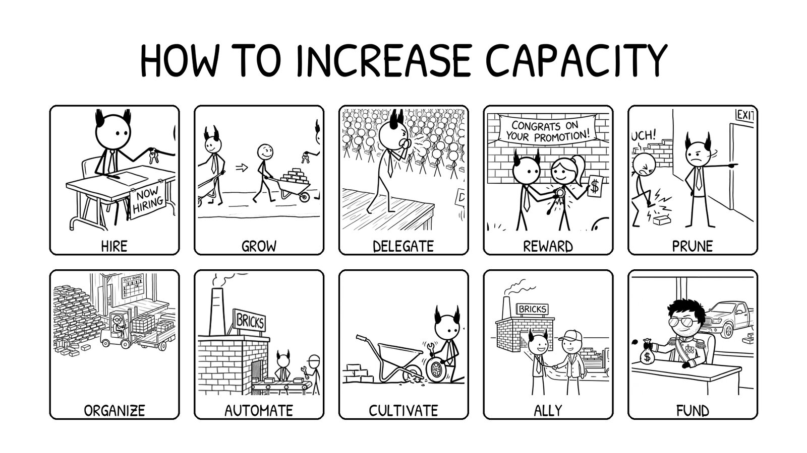

> Everything on this slide pays off in months or years, not this week, which is why it always loses to this week's fire. Nobody will ask you on Friday why you didn't do a skip-level or fix the on-call rotation. Six months later, everyone will ask why the team is still slow. Block time for these the way you block time for a launch.

> Hiring is the second thing your CEO judges you on, after delivery, because it's where everything else becomes visible: candidates can smell your culture, your strategy and whether you grow people.
> - Hire for the gap, not the clone: the team that's all backend needs the person who has shipped mobile.
> - One great senior hire can be worth three average ones; a bad hire is net negative and costs months to undo.
> - Make your recruiter a real partner: if they can't explain why the role is exciting, candidates won't feel it.
> - Every interview loop costs the team 5–10 engineer-hours. Budget for it.
> Hiring is slow capacity: it takes 3–6 months before a hire is fully ramped. Start before you're desperate.

> This could be a whole set of talks. Three parts:
> 1. Opportunities: give people work one size bigger than their last job. The mid-level engineer leads the next design review; the senior engineer owns the launch.
> 2. Mentorship: show how to do the job. Do it together first: you run the incident review while they watch, then they run it while you watch.
> 3. Coaching: support them while they do the job on their own. Weekly 1:1s, feedback within days, and questions instead of answers.

> At some point your own hours are the bottleneck. Delegating is how one manager's capacity becomes several.
> - Tech leads who own the technical calls, so design decisions don't queue behind you.
> - A second-in-command who can run the team for two weeks while you're out, and actually does it.
> - Hand off whole problems (the release process, the on-call rotation), not tasks.
> - Let them do it differently than you would. If it's 80% as good and you didn't have to do it, that's a win.
> The test: if you disappear for a week, does the team slow down?

> "My job is to leave money in your pocket and memories in your head."
> - Pay fairly and proactively: fix the underpaid engineer before they get the outside offer, not after.
> - Equity and refreshers tied to impact, explained clearly.
> - Recognition that's specific and public: name the person and what they did, in the all-hands, not just in a DM.
> - Non-money rewards: the interesting project, the conference talk, the promotion case you write for them.
> Money prevents a no. It rarely creates a yes.

> Sometimes capacity goes up when someone leaves.
> - One person who blocks every review, or who the team quietly routes around, slows down everyone near them.
> - Values rarely change; skills can. Coach skill gaps. When it's values, move faster than feels comfortable.
> - Be clear early: written expectations, a real plan, a date. Nobody should be surprised.
> - "Not firing fast enough" is one of the most common regrets of experienced managers.
> Do it with dignity. The rest of the team is watching how you treat people on the way out.

> Assign is who carries which brick this week. Organize is the structure that makes that call for you every week, so you can work on the next route. The shape of the team decides how much it can do.
> - Clear ownership: every service, every alert and every customer issue has one team that owns it.
> - Small teams with few dependencies ship faster than one big team with many.
> - Few, explicit handoffs: product to engineering, engineering to QA, QA to support.
> - An on-call rotation that doesn't burn out the same two people.
> - Just enough process: a weekly plan, a retro, a postmortem. Kill the meetings nobody would miss.

![Slide 32: Automate. Side view of one road from a brick factory with a BRICKS sign on the left to a house with flag B on the right. Left to right: the Manager and two engineers in hard hats with wrenches at a conveyor belt by the factory; a dump truck full of bricks on the pavement; a steamroller at the end of the pavement; a small truck of bricks on leveled dirt; a bulldozer; a person pushing a wheelbarrow of bricks; a person rolling a boulder; and one person carrying a single brick over rocks to the house.](slides/32.jpg)

> Every hour of toil you remove pays back every week after. Each level of technology is roughly 10x the last, and you build the next level while the current one keeps delivering.
> - The page that costs an hour a week and takes 12 hours to fix pays back in 12 weeks. Fix it.
> - CI that takes 40 minutes taxes every PR, every day.
> - Deploys that need a person and a checklist become deploys that need a button.
> - Pay down the tech debt that slows every feature, not the debt that just looks ugly.
> - AI agents on the repetitive work: test writing, migrations, triage.
> Build it while you keep shipping. Stop delivering to build the perfect tool, and you lose the week and the trust.

> Culture is what people copy. Your team copies what you do, not what you say, and the next hire copies them, long after they've stopped watching you.
> - You break prod: you write the postmortem, and it starts with your own mistake. Six months later, a junior engineer opens theirs the same way.
> - You fix the flaky test instead of hitting re-run. Your tech lead stops re-running, and so does the new hire.
> - You review PRs within a day, with a real comment, not just LGTM. That becomes the team's review bar.
> - You say "I don't know, let me find out" in a design review. People stop bluffing.
> Then make it explicit: a few words people can act on, like "Rigorously Get Shit Done". Reward what you say you value; if you say quality but celebrate only speed, the team copies speed. Hire and fire by it.
> It's slow to build and fast to lose.

> Other functions' capacity can become yours. Engineering can't win alone, and the partners who trust you will spend their capacity on your goals.
> - Product: a partner, not a requester. You plan the roadmap together, they cut scope with you instead of around you, and they bring you to the customer.
> - Sales: they tell you which deals need what, months before the contract is signed, and they don't sell the feature you haven't built. In return, you give them dates you actually hit.
> - Also: the platform team that adds the API you need if they hear about it a quarter ahead, and the recruiter who moves faster on your hires.
> Alliances are built before you need them, not during the crisis.

> Headcount and budget are capacity, and you have to earn them.
> - A hiring plan and a comp plan that tie each dollar to an outcome the CEO cares about.
> - Stay on budget, and share bad news early. Nothing builds CEO trust faster.
> - Ask for the truck with a business case: what it costs, what it unlocks, when it pays back.
> - Start small and earn more: a two-day draft, reviewed together, then sharpen the numbers.
> Every yes from the CEO is spent from trust you built earlier.

> Twenty buckets. Nobody does all twenty every week, and nobody should try. I don't. In any given week, two or three of them matter, and the rest can wait. The hard part isn't knowing the buckets; it's knowing which two or three this week, because the world keeps changing under you.

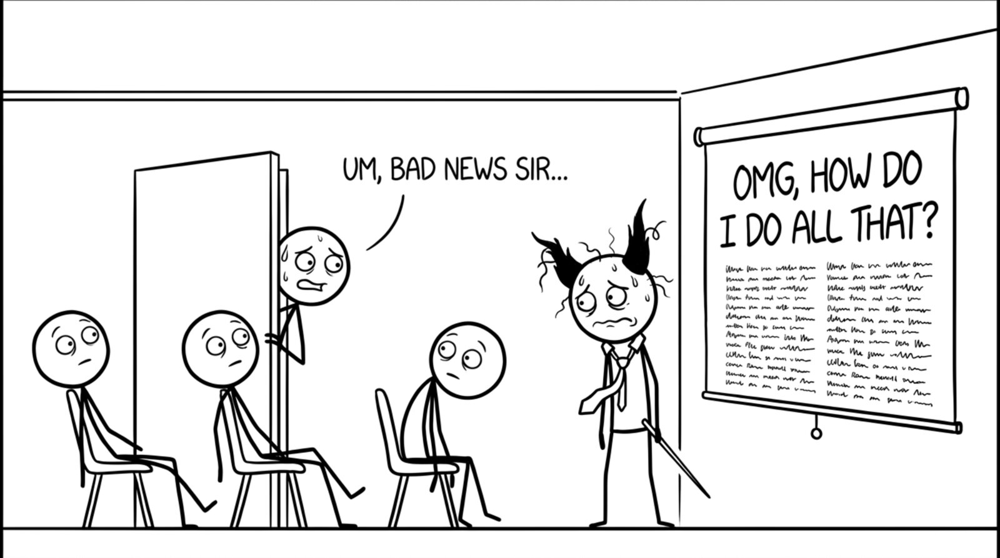

> Let it sit for a second. You will get this message on the day you finally have a plan you like. Every manager has had the Slack DM that starts with "hey, got a minute?" at 4:55 on a Friday. It's not a sign the plan was bad. It's what the job actually looks like.

![Slide 38: A bland Jira-style burndown chart: story points from 05 Jan to early July. A thin gray Guideline runs straight from 9,000 to zero. A blue stepped Total Scope line jumps up twice, in February and April, is cut back each time, and drops again at the very end. A red stepped Remaining Values line jumps with it, burns down on weekdays and stays flat on weekends, and reaches zero at the end. On a right axis, a green stepped Velocity line, in story points per day, dips twice and climbs from about 40 to about 220. Pale gray bars mark weekends. Legend at the bottom: Guideline, Total Scope, Remaining Values, Velocity (Story Points / Day).](slides/38.jpg)

> Read it in your most monotone voice. Reality is incredibly messy: unpredictable things happen all the time. This is how half a year of it looks in the status meeting: two bumps and a line that hits zero. All the chaos is in there; you just can't see it anymore.

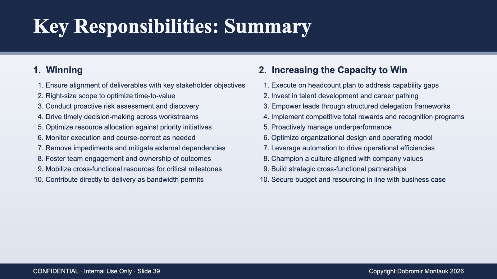

> Don't read it. Let the room scan it for a few seconds. Every one of these is a slide we just did, with all the life squeezed out. This is what the job description says.

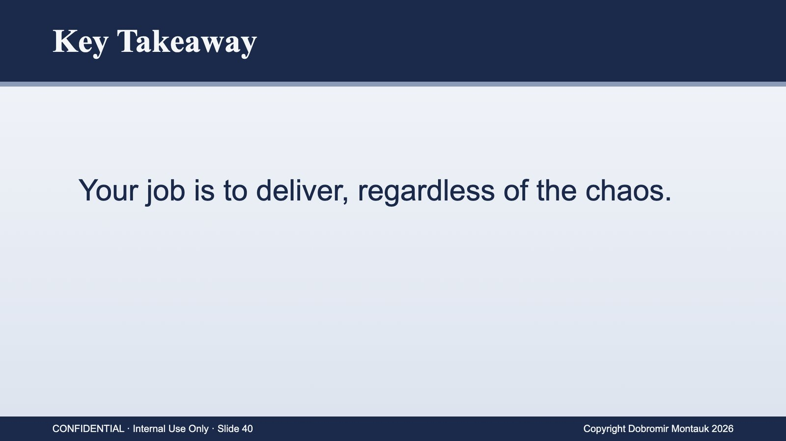

> Flat, like the cover. Pause. It's true, and it sounds like nothing. Then click.

> Drop the corporate voice. It's the hardest job I know and the most fun I've had. Thank you.
