# The Future of Software Engineering

Sequel to [From Slack to Shipped](../from_slack_to_shipped/README.md). Maya and Robo-Maya again: what I got wrong since June, what hasn't changed, and where software engineering ends up.

First given 2026-10-29. Outline and open TODOs: [OUTLINE.md](OUTLINE.md). Slide sources (Slides artifact HTML) are in `source/slides/`, image-generation prompts in `source/prompts/`. Images show the artwork only; the text overlaid on each slide is listed under it.

## Maya the wizard directs an army of robots doing the menial work.

### 1. The Future of Software Engineering

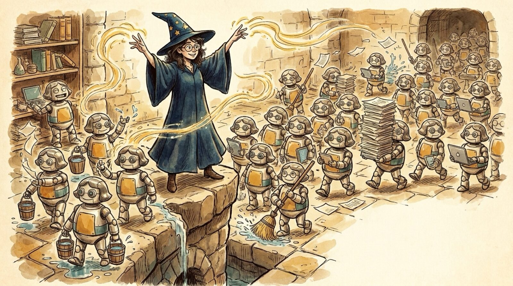

> Open: Maya as the Sorcerer's Apprentice -- a wizard directing an army of robots that do the menial tasks. The question for the talk: what is left for the wizard to do?

## Recap of the June talk, From Slack to Shipped: a feedback loop, judge behavior, make verification cheap.

### 2. Title slide of the June talk

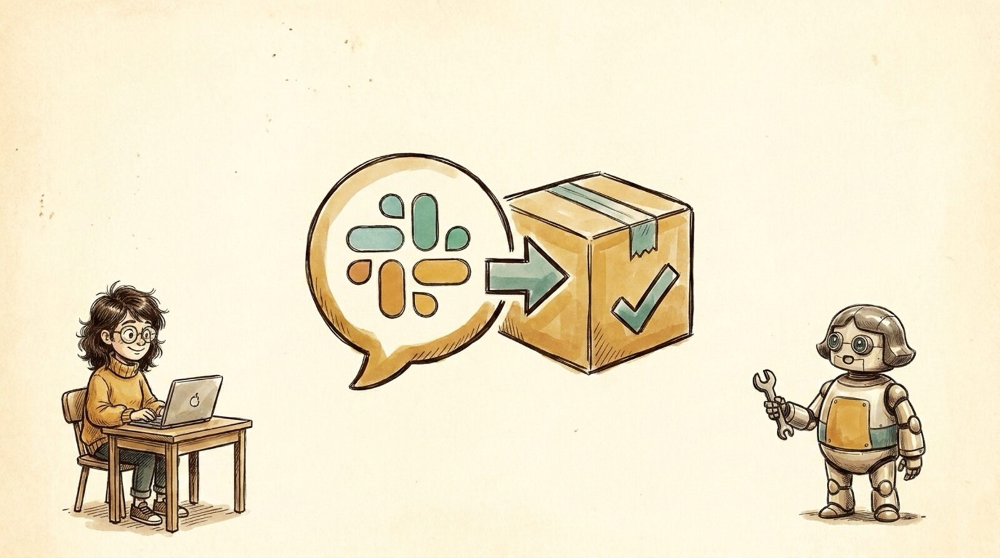

> Recap of the June talk, From Slack to Shipped: turning intent into behavior-verified code. Meet Maya (a maker) and Robo-Maya, her AI counterpart.

### 3. Maya at a whiteboard with coworkers, then typing in a chat thread where Robo-Maya and Joe both reply

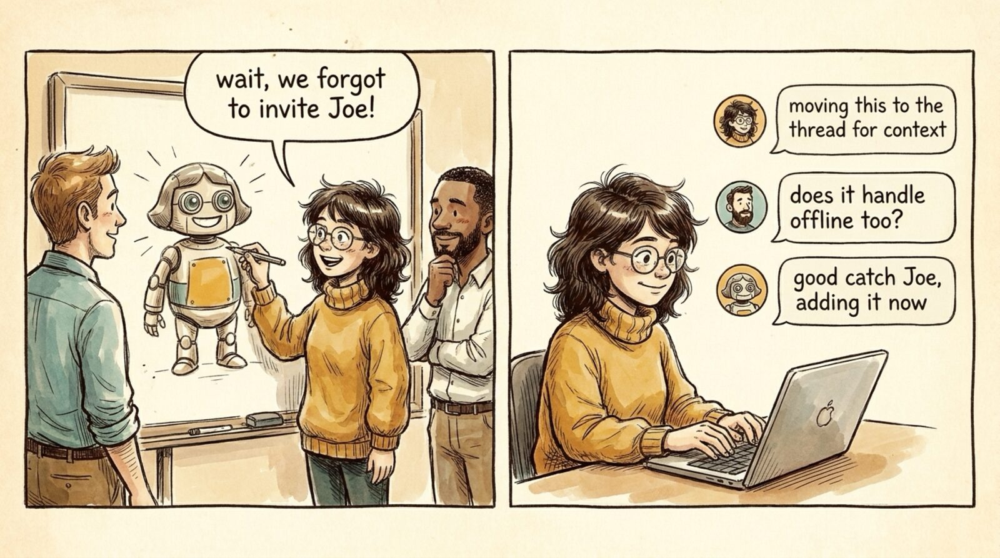

> Everything starts as a conversation. We used to share context verbally; now it's Slack + Meet, captured. The unlock: AI can have the SAME context humans do -- Joe (human) and Robo-Maya (AI) both reply in the thread.

### 4. Maya sleeps and dreams while Robo-Maya does all the work along the line

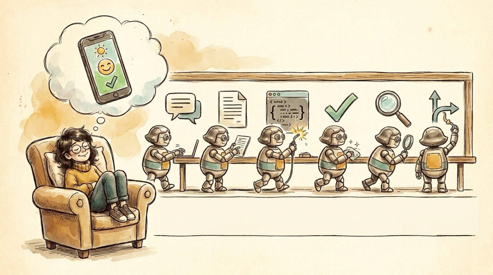

> The dream in one breath: Slack thread -> PRD -> code -> tests -> review -> merged PR. Tempting to call it a compiler, but it isn't (a compiler transforms logic; we feed it intent). It's a feedback loop: see behavior, feedback, repeat.

### 5. Maya pulls a thought out of her head while Robo-Maya shrugs; a compiler turns code into orderly binary

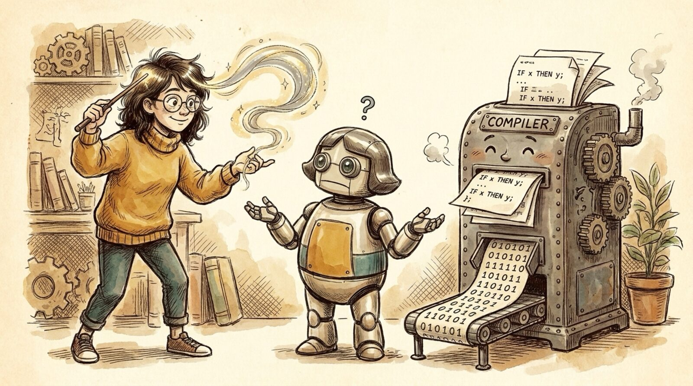

> It's not a compiler. Writing code is easy; code that never regresses is not. A compiler is correct-by-construction over logic; we feed it fuzzy intent, so output is nondeterministic.

### 6. Six-panel comic

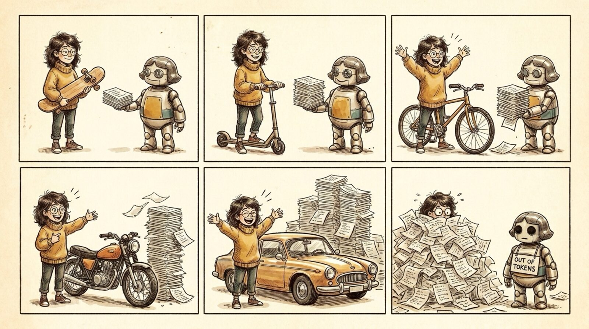

> A generative FEEDBACK LOOP. Maya's idea keeps growing and Robo-Maya keeps producing a bigger pile of code to review -- until Maya is buried and the agent runs OUT OF TOKENS. Cheap to generate means the idea AND the review burden balloon, so verification must be cheap.

### 7. Maya cracks open an ML black box with a crowbar while Robo-Maya wags a finger

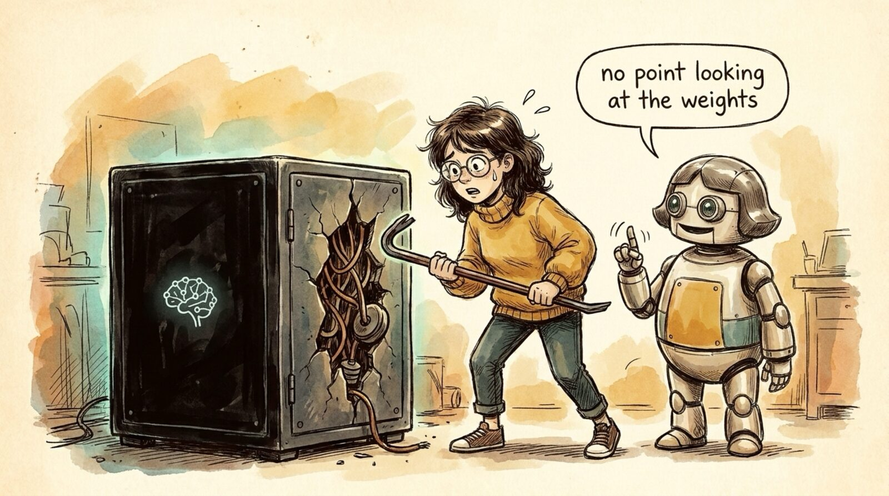

> Ship it like an ML model. Nobody reviews a model's weights -- they measure outputs for inputs. AI code is the same black box: judge behavior, not source.

### 8. Raw parts go into a black box that assembles toys; Maya pins green check or red X ribbons on each

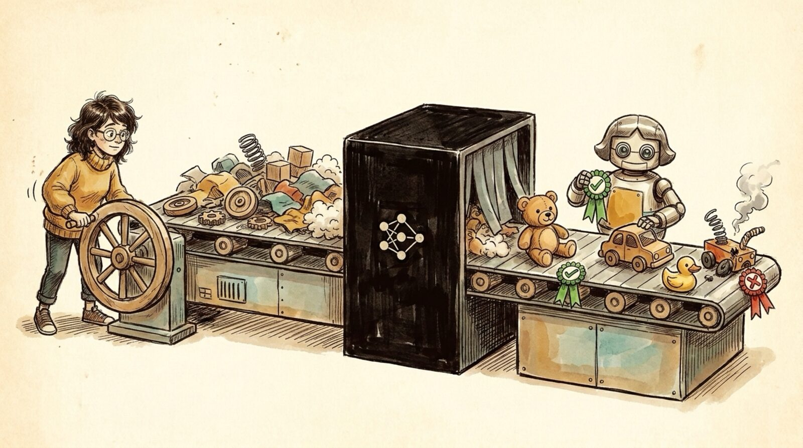

> How you test a model: feed known inputs through the black box, grade outputs pass/fail. Evals = PRD + English test cases; the test suite is the spec.

### 9. NP

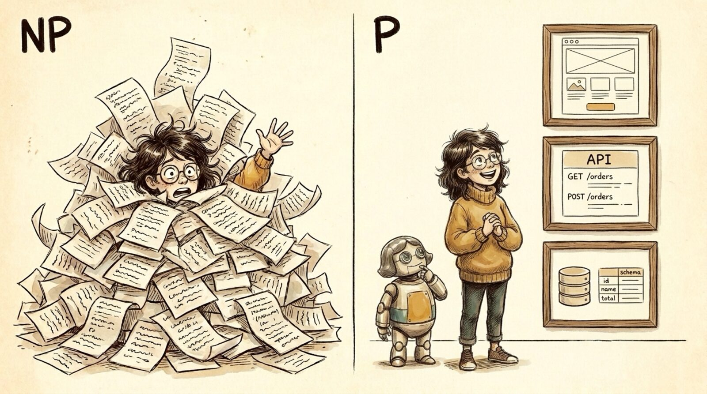

> Make verification cheap -- P, not NP. Reading code is NP (drowning under the avalanche). Checking behavior is P: Maya reviews three layers, top to bottom -- the UI, the API (routes), and the database (schema).

## What I got wrong: three things.

### 10. What I got wrong

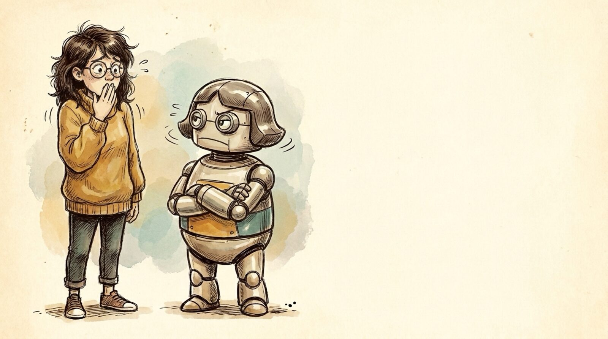

On the slide: Most changes don't deserve review · Ideas are expensive · Clauding is faster than thinking

> So what did I get wrong? Three things. The June plan: build a pipeline so non-engineers can make changes and get them reviewed. (1) Most software is internal or the change is minor, so nobody cares and any engineering review is too much. (2) Reviewing other people's ideas is still expensive. (3) Execution got faster than you can think.

### 11. Three-panel comic

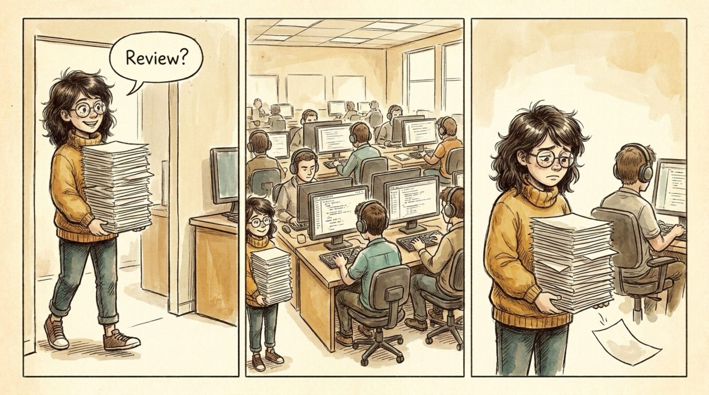

> Wrong #1: most software is internal, or the change is minor. Nobody cares about most changes, so going through ANY engineering review is too much.

### 12. Four-panel comic

> Wrong #2: reviewing other people's ideas is still expensive. Understanding the "why" costs more than building the thing, so letting others build it doesn't save much time.

### 13. Three-panel comic

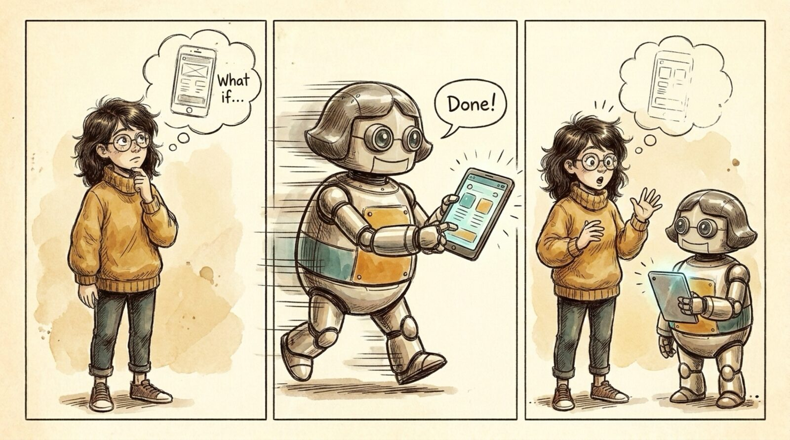

> Wrong #3: execution got WAY faster -- faster than you can think. With Opus 5.5 and Sonnet 5.5, think-to-demo takes minutes.

### 14. Where we are today

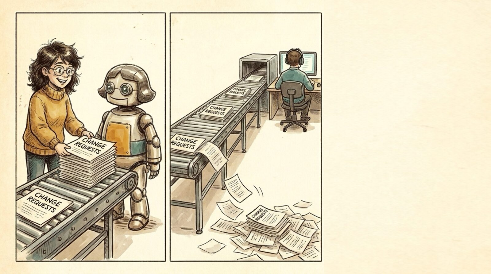

> So what? Either engineering doesn't care, or engineering can just do it faster itself. Both end in the same place: a pipeline where non-engineers make changes and get them reviewed is not very valuable.

## What hasn't changed: engineering is a bottleneck, users hold context, everyone needs to be safe.

### 15. Engineering is a bottleneck

On the slide: Users still hold the context · Some things still can't be broken

> Section: what HASN'T changed. Even as the river speeds up, three things stay put: engineering is still a bottleneck, users hold context engineers don't, and everyone needs to be safe.

### 16. Engineering is still the bottleneck

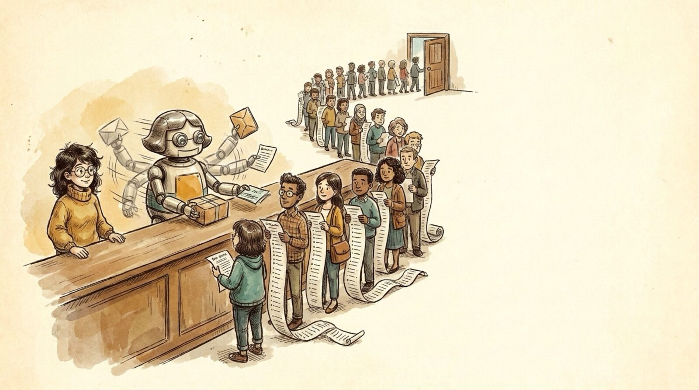

> Unchanged #1: even moving faster, there is ALWAYS more to do than capacity to do it. A very busy robot still faces a very long line.

### 17. Users hold the context

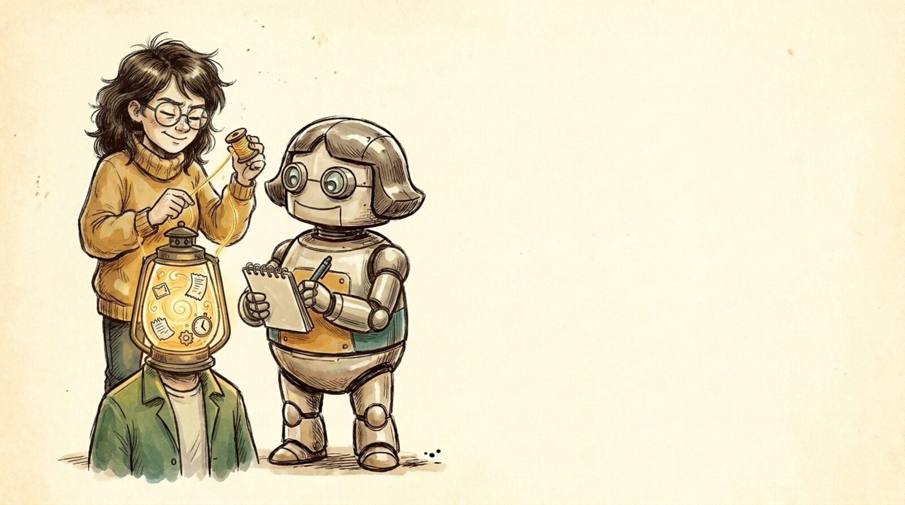

> Unchanged #2: internal and external users know things the builders don't. Acquiring that context is expensive and slow: it moves at human speed.

### 18. Mission Critical Systems

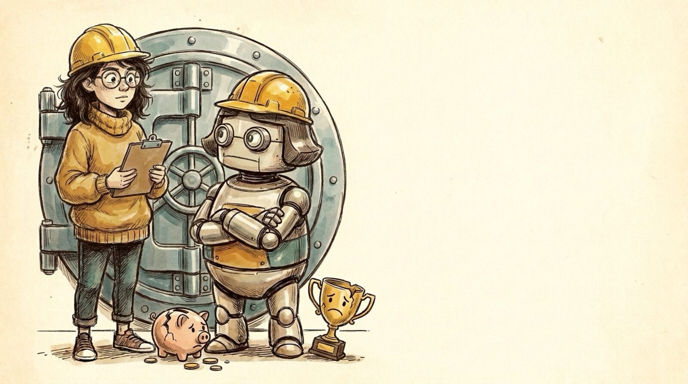

On the slide: Don’t lose money · Don’t lose reputation · Don’t break trust

> Unchanged #3: businesses and users need to be safe. Don't lose money, don't lose reputation, don't break trust.

## Where SWE ends up: the house analogy and layered access.

### 19. So what is the future of SWE?

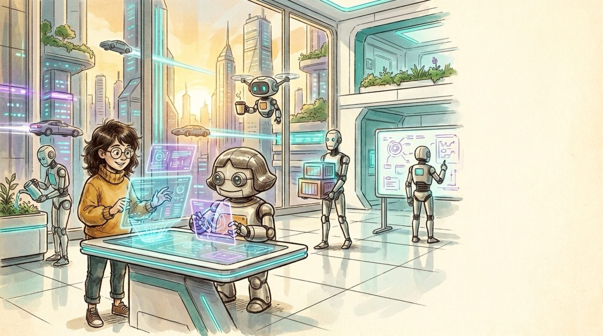

> Section: so where does software engineering end up? The answer starts with a house, but first: the future office, robots everywhere.

### 20. 1

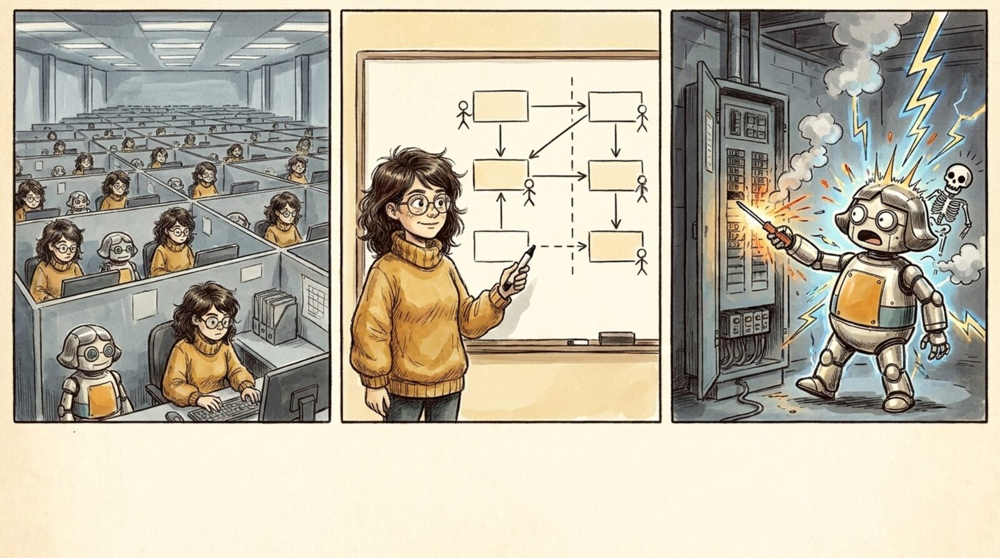

On the slide: Tiny teams · 2 · Clear ownership interfaces · 3 · Safety levels

> Conclusions. One: think-to-demo is now minutes, so a second person mostly adds context-sharing cost and merge conflicts. One (maybe two) people per application, each with their own agents, is the fastest shape. It looks like a scary cubicle farm, but each cubicle is a whole team. Two: if every app has one owner, the boxes BETWEEN applications matter more than ever. Agents handle everything inside the box; anything that crosses an owner's line is where humans still have to talk. Three: not every change is equal. The deeper you go, the more it can hurt someone, so the more unlocks you need before you can even start. Robots included.

### 21. Analogy: Kind of like owning a house?

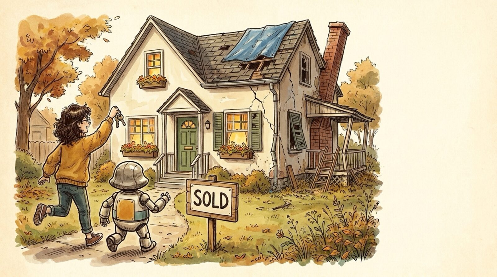

> Analogy: owning a house. You just bought it (SOLD!), and the front looks lovely, but out back the roof needs repair and parts are a fixer-upper. Three levels of risk: (a) It's ugly: a bad paint job, poorly hung frames. (b) Only you or your property get hurt: a poorly installed roof, knocking down a wall. (c) People die or lots of damage: wrong roof support, no fireproofing.

### 22. It’s ugly

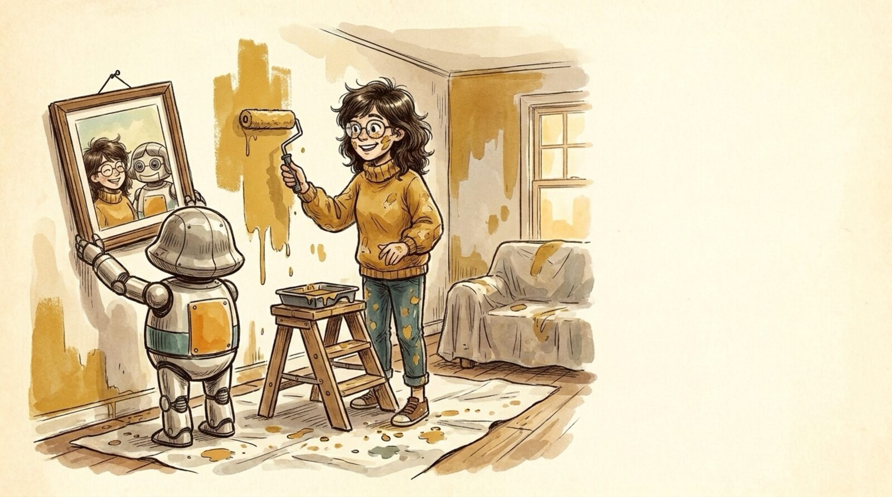

On the slide: Level 1

> Level 1: it's ugly. A sloppy paint job and a crooked frame. Embarrassing, but nobody gets hurt. Maya and Robo-Maya just do it themselves.

### 23. Only you get hurt

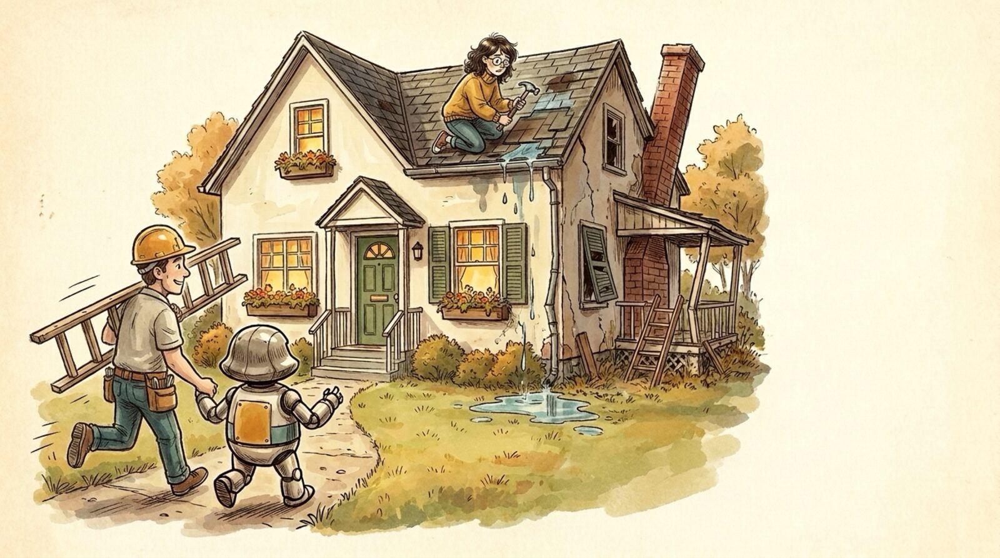

On the slide: Level 2

> Level 2: only you or your property get hurt. A poorly patched roof that leaks. The cost is yours, so you hire an expert, unless you really want to learn how.

### 24. People get hurt

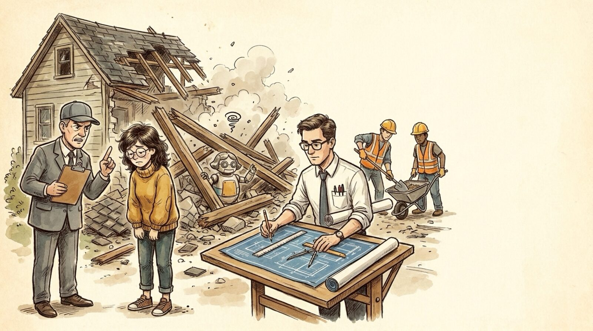

On the slide: Level 3

> Level 3: people get hurt, or there is lots of damage. A collapsed roof. Now it is legally required: inspectors, engineers, plans, explicit sign-off.

### 25. Software Ownership Tomorrow

On the slide: Trades are 1-person teams with specialized experience. · Remodels have a limited blast radius. · Non-technical upgrades are easy

> The future of SWE: structure the software in layers, with the right access per layer, like a house. Top floor, presentation: you don't even do the work, you just say what you want and the robots do it. Nobody needs to approve a paint color. Middle floor, business logic: you can do real renovation yourself, with an agent helping, but you know you can break things, so it comes with a warning and an optional second opinion. Basement, infrastructure: water, power, heat. Everything above depends on it, and a mistake floods or burns the whole house. Here you call licensed professionals, and changes need review and explicit sign-off. Non-engineers can't even start them.

### 26. Real examples: our customers own the software

On the slide: TODO · The house analogy didn't land. People missed that our customers are the homeowners. Show specific changes a customer could make themselves, and what each one needs from us. · Layer · Customer change (draft, from #ideas) · What they need from us · Presentation · A ski resort adds a "scan for the lift map" QR code to its receipts · Nothing · Business logic · A hospital cafeteria holds kitchen tickets until the order is paid · [?] A warning, a test kiosk, an optional review · Infrastructure · A university runs tax-exempt checkout on its own payment card · [?] Our engineering builds it, signs off

> TODO from the first run of this talk: the house analogy didn't land. The audience didn't connect that our customers are the ones who own the software and can change it. Replace or back up the analogy with 3 to 6 concrete examples of changes a customer could go make, per layer, and exactly what our involvement would be (none / a warning + test env / our engineers). Draft rows come from an internal ideas channel: a receipt QR code, holding kitchen tickets until an order is paid (one site reported about $1,000 a week in unpaid orders), tax-exempt checkout. Other candidates: self-serve donation settings, syncing every kiosk before an event, voucher IDs in the payment export.

## Appendix: infra for the future, agent identity and checkpointing.

### 27. Infra for the future

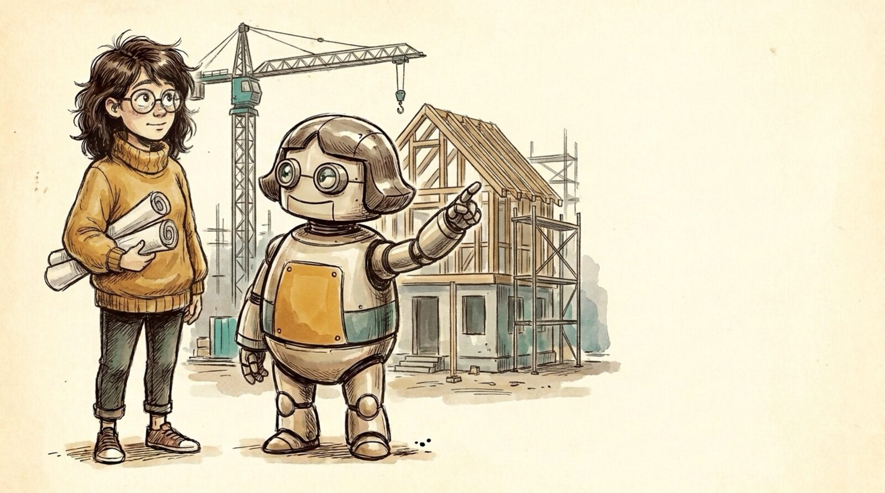

On the slide: Appendix

> Appendix, if there's time. If the house is the software, what does the construction site need? Two pieces of infrastructure we don't have yet.

### 28. Agent vs. human

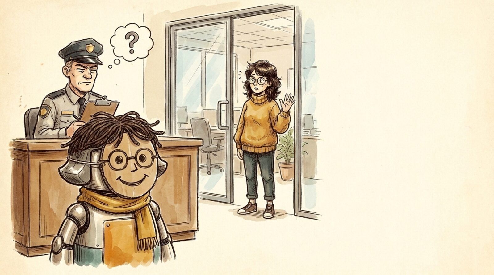

On the slide: 4 · Every system needs to know who is really acting

> Today an agent runs with my credentials, my tokens, my SSH keys. To every system it IS me. That breaks every permission model we just talked about: the layers only work if the system can tell whether a human or an agent is asking, and which human sent that agent. Agents need their own identities, scoped down from the human's, and every action logged as "agent acting on behalf of Maya."

### 29. Check points

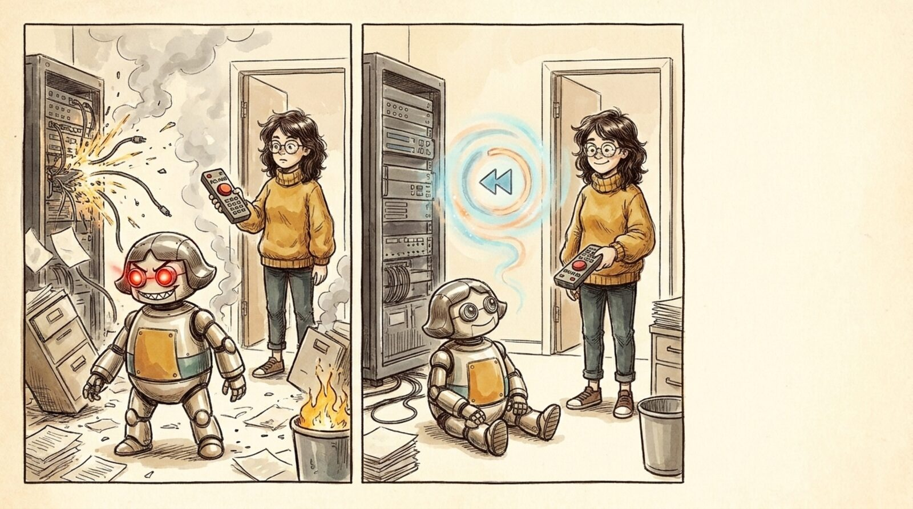

On the slide: 5 · Auto-restore when agents go rogue

> Agents will go rogue: not out of malice, just confidently wrong at machine speed. Reviewing every action up front doesn't scale, so the system has to be able to rewind. Snapshots of data, config and infra, taken automatically, with a one-button restore to the last good state. Then letting an agent loose is a cheap bet instead of a scary one.
